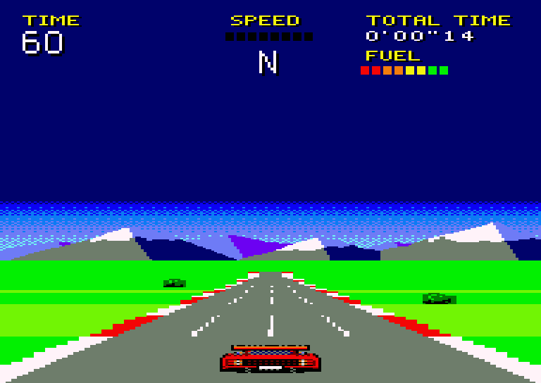
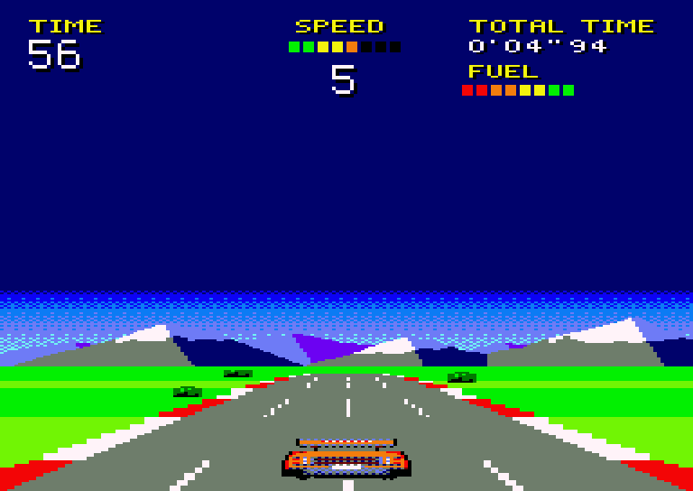
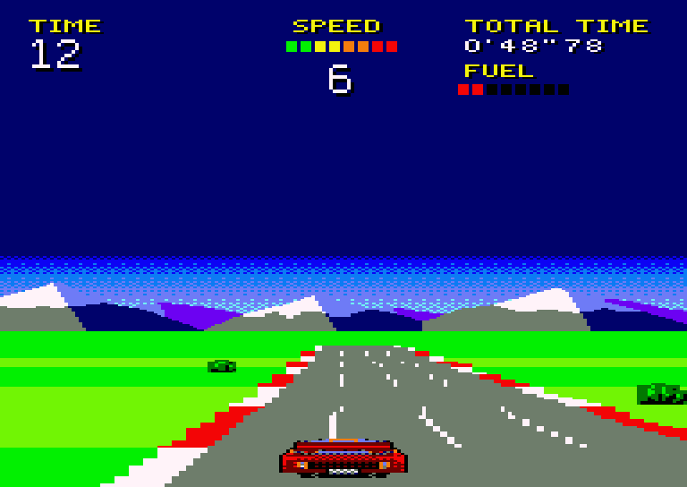
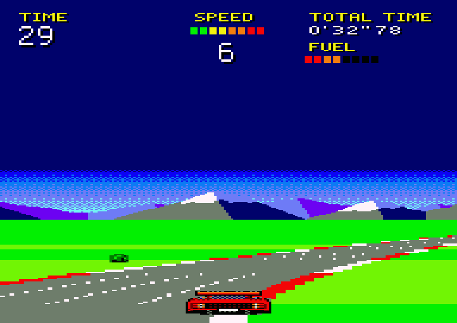
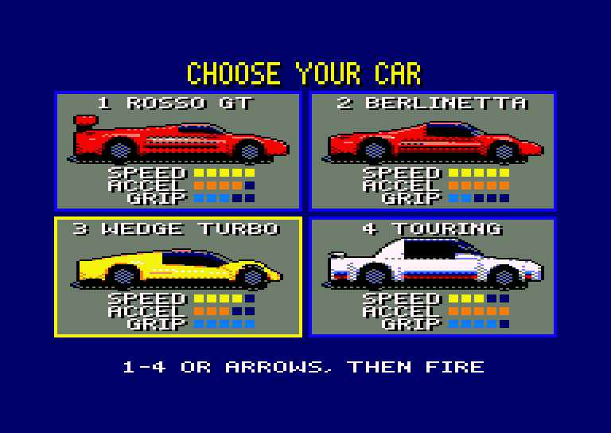

# Country Ride

A racing game for the Amstrad CPC 6128, written in Z80 assembly.



This is the first milestone: the screen layout, the road engine and the
player's car. A demo drive runs a four-lane road over a looping run of
crests, dips and curves - never a curve on a hill - with bushes of different
sizes beside it at random intervals, at 25 frames a second, and fills the HUD
with plausible numbers. Press left or right and you steer: the car stays in
the middle of the screen and the road moves under it, and a curve carries
the car out of it unless you steer against it.

| Crest ahead | In a dip | The sharpest curve |
|---|---|---|
|  |  |  |

## Building

You need:

- [rasm](https://github.com/EdouardBERGE/rasm), the assembler;
- [iDSK](https://github.com/cpcsdk/idsk), to put the BASIC loader on the disc;
- `python3`, but only to regenerate the sources in `src/gen/` (which are
  committed), and Pillow for the pictures.

Then run:

```bash
make
```

This writes `build/countryride.dsk`.

## Running

Insert `build/countryride.dsk` in a CPC 6128, or any emulator of one, and type:

```
RUN"COUNTRY
```

Pick a car (below), then steer with the cursor keys, O and P, or a
joystick: left and right.
Faster: cursor up, Q, space, joystick up or fire; slower: cursor down, A,
joystick down. Until you first press one of them, the demo drives - and it
keeps its own speed until you first press faster or slower. With neither
held the car slows down a little; with a wheel on the grass (the road 20
pairs or more to one side) it goes no faster than half its top speed.

The game needs the 6128's second 64K: it uses banks 4 to 7. So far it has
been tested in emulators: the harness below, and Retro Virtual Machine. The
split screen (raster ruptures, below) is built not to depend on what the CRTC
types do differently; it has not been tried on real hardware yet.

## Make targets

| Target | What it does |
|---|---|
| `make` | builds `build/countryride.dsk` |
| `make gen` | regenerates `src/gen/*.asm` from `tools/` and `assets/` |
| `make check` | boots the disc in an emulator, measures the frame rate, and compares the screen with the Python model |
| `make shots` | boots the disc and writes the screenshots in `docs/` |
| `make mockup` | writes `build/mockup.png`, the screen as worked out in Python |
| `make clean` | empties `build/` |

## The screen

The screen uses overscan in mode 0: 192 × 272 pixels (96 bytes a line), 16 colours.
On the flat it is:

| Lines | Share | What |
|---|---|---|
| 0–63 | ~1/4 | HUD on navy: TIME, SPEED gauge with the gear (N–6), TOTAL TIME, FUEL gauge |
| 64–135 | ~1/4 | navy, the HUD's colour |
| 136–179 | ~1/6 | dithered sky fading into the navy, snowy mountains up to 28 lines high |
| 180–187 | | a band of ground |
| 188–267 | 3/10 … 1/4 | the road: 80 lines on the flat, 66 behind a crest |
| 268–271 | | black: a monitor's edge hides these, and drawing them took ~0.7 ms a picture |

The sky, the mountains and the road take the screen's bottom half. (Until
2026-10-26 the horizon was higher: the sky from line 64, the mountains up to
44 lines, the road from line 163 - 105 lines. Lowering it made every picture
~4.5 ms cheaper.) The road's top rises and falls between 3/10 and 1/4 of
the screen, and the horizon goes with it. When a crest hides the far road,
the sky and the mountains move down, twice as fast as the road's top at
first, and the lines above them fill with the HUD's navy. The band of
ground between the mountains and the road - what the crest does not hide of
the far side - goes from 8 lines on the flat to 3-7 behind a crest. It cannot go to none: the
road part has to start at a character row, so the mountains can come no
nearer to the road's top than the row it is in (*Horizon drop* below), and
they move at most 2 lines a step, never in jumps.

The road bends left and right, from nothing at the bottom, where the car
is, to the most at the horizon; in the sharpest curves the far road
leaves the screen. The sky and the mountains turn sideways as the road
bends, by hardware scrolling.

The road has four lanes, each a little wider than the car. It
has thick red and white kerbs. The asphalt is plain grey and the grass plain
green: the stripes are in the kerbs and the lane dashes, which move all the
way to the horizon; past the striped zone their dashes get longer with
distance, so they don't flicker. The road never narrows to a point: far away
it is still 10 pixels wide, kerb to kerb.

Bushes stand on the grass on either side, at random intervals, in three
sizes and at different distances from the road. They grow as they come
nearer, from 5 to 16 lines, and leave by the sides of the screen.

Before the race the player picks one of four sports cars, seen from the
side on the screen the loader shows while the game loads: a red one with a
rear wing (ROSSO GT), a wide red one with a grille of black slats right
across its tail (BERLINETTA, after a Ferrari Testarossa), a low yellow
wedge with a louvred engine cover (WEDGE TURBO, after a Lotus Esprit) and a
white saloon with a wing on its boot and stripes in light blue, dark blue
and red (TOURING, after a BMW M3 of the eighties). 1-4 picks one and
starts; the arrow keys, O and P or the joystick move the flashing frame,
and fire, space or return start.

They drive differently - speed, acceleration and grip, shown as bars of
five (`scene.py` `CAR_LEVELS`; `car_setup` puts them into the code that
drives the car):

| | Speed | Acceleration | Grip |
|---|---|---|---|
| ROSSO GT | 5 | 4 | 3 |
| BERLINETTA | 5 | 5 | 2 |
| WEDGE TURBO | 4 | 3 | 5 |
| TOURING | 3 | 5 | 4 |

Speed 5 is the top speed of 6.6 depth units a VSYNC - the most the
pictures keep up with - 4 is 6.1, 3 is 5.7; on the grass, half. Acceleration
3 to 5 is 4 to 6 (1/256 depth units a VSYNC, every VSYNC): full speed in 8.4
to 5.6 seconds. Grip is how fast the car is steered across - 3 pairs a
picture, 4 with grip 4 or 5 - and how little a curve carries it out of it:
a pair for every 40, 48, 56 or 64 of the curve level times the speed.



In the race the car is seen from behind, low down, 40 or 44 pixels wide
and up to 27 lines high, a little above the bottom of the screen. Steering,
it is seen turning, OutRun's way: turning left, it turns about its rear
axle, its nose going left, the left flank and the hubs of its tyres in
view.

The cars are photorealistic renders of 3D models (`tools/cars3d.py`, in
Blender with Cycles: paint under a clear coat, glass that mirrors the sky,
rubber, alloy rims, lenses lit from within, a sun behind and a sky). Their
bodies are curved: each is lofted along the car through rounded sections
(superellipses, from nearly square to round) whose width, height and
roundness follow smooth curves from the tail to the nose (`tools/car3d.py`
`Shape`, `loft`) - a rear face with rounded shoulders, hips over the rear
wheels and a waist at the doors, a bubble of a cabin with a painted roof,
sails, a nose rounded in plan and in profile - with the wheel arches cut
into them and fenders swelling over the wheels. They are brought
to mode 0 by `tools/dither.py`: each mode 0 pixel takes the mean colour of
the 128 render pixels under it, over the asphalt's grey, made more
saturated and its darks darker, and then the nearest pen - or, where two
neighbouring pens of a ramp (dark red, red, orange, yellow, white; black,
navy, blue, sky, pastel, white; the greys) mixed in a checkerboard come
clearly nearer, that checkerboard: CPC dithering, flat where the paint is
flat. The asphalt's grey only in a checkerboard, never alone: a grey pixel
would look like a hole. Each car has nine views - on the level, going
uphill and going downhill (pitched 8 degrees before the car is squashed as
low as the game draws it), each straight, turning left and turning right
(the left view mirrored) - in `tools/carsart.py` (`tools/mkcars.py`, which
also draws `build/cars-sheet.png`). In the race the car is seen uphill
where the road ahead climbs - the hill 20 or more into a dip - and
downhill where it falls away, over a crest (`car_lines`). The side views have the select screen's own sixteen pens (pink
for the red paint's highlights, pastel cyan for the white car's and the
glass's: `tools/mkselect.py`).

## How it works

### Frames

There are two screen buffers. The game draws into the one not on screen. The
interrupt handler (IM 2) shows the new buffer at a VSYNC at least two frames
after the last flip, which gives a steady 25 Hz. The game logic steps at
50 Hz. If a picture is late, it catches up by up to four steps.

### The split screen

The picture is three parts, each in its own memory:

| Part | Lines on the flat | Memory |
|---|---|---|
| HUD | 0–63, then navy border to 131 | page 1, one copy per buffer |
| sky and mountains | 132–179 (navy to 135) | page 3, one copy for both buffers, in a ring |
| road | 184–271 (180–183 are border) | page 2 (buffer 0) or page 0 (buffer 1), from line 160: 160–183 never shown |

The interrupt handler reprograms the CRTC three times a frame (raster
ruptures), so every frame is three CRTC frames with their own start address,
row count and R5 lines.

- **Horizon drop.** When the road's top is *d* lines down, the sky goes
  *s* lines down: twice *d*, but no further than the road part's first line
  less one, and at most 2 more than for *d* − 1 (`scene.sky_drop`, a table
  in the interrupt handler, with the 68 lines from the HUD to the sky part
  added). The HUD part ends in navy border: its last row (navy anyway),
  (68 + *s*)/8 more rows, all hidden by R6, then (68 + *s*) mod 8 R5 lines -
  4 on the flat. So the sky starts at line 132 + *s*.
- **Road start.** The road part starts at the character row the road's top
  is in. Between the two parts is green border (a row if needed, then R5
  lines), so the road lines are always where they are in memory, and the
  road renderer knows nothing about any of it.
- **R5 lines.** CRTCs differ in them: some make them border after the last
  row, others keep showing the next row (Retro Virtual Machine did, as dashes
  under the HUD and a black bar under the mountains). So they are fewer than
  8, the HUD part's come after a border row, and the ring row after the sky
  part's last is kept green, the colour of the border there.
- **When registers are written.** A part's start address is set in the part
  before it, never in a part's first row (type 1 rereads it on every line
  there); a part's size is set while it, or the R5 lines just before it, are
  on screen; R6 only well before or after the row it names.
- **Sky ring.** With MA10/MA11 at 0, the CRTC's address wraps every 1024
  characters (2K). The sky part is 6 rows of 48 characters in that ring.
  Moving its start address one character scrolls it a word (4 pixels)
  sideways for good; only the column that comes in has to be written, from
  the panorama (384 pixels, stored by columns in bank 7). That takes
  ~1.4 ms, done at the flip, before the sky part is on screen, so it never
  tears. The dithered sky repeats every word, so only the mountains seem to
  move.
- **Timing.** The Gate Array interrupts come at fixed lines (~274, 14, 66,
  118, 170, 222), and each handler sets up the next one's, so none has to
  work out where the frame is. Each register is written with more than five
  lines to spare. The HUD part's rows run on to line 131 or further, so the
  sky part's size waits for the interrupt at ~170, in the sky part. The VSYNC's handler checks that it is in VSYNC; if a frame
  is ever out of step, the handler falls back to a plain frame until the
  next VSYNC.

### Memory

The CRTC always reads the base 64K:

| Page | Holds |
|---|---|
| 0 | buffer 1's road part, common fragments |
| 1 | both HUDs (`#4000` with RAM C1), the bush sprites' code beside them |
| 2 | buffer 0's road part, common fragments |
| 3 | the sky ring (`#4000` with RAM C3) |

The banks hold the rest:

| Bank | Contents | Seen at |
|---|---|---|
| 4 | road templates (`#4000–#5FFF`), code (`#6000`) and the next step's staging set (`#7E00`) for stripe band A | `#4000` (C4) |
| 5 | road code (`#4000`), the next step's staging set (`#5E00`) and templates (`#6000–#7FFF`) for stripe band B | `#4000` (C5) |
| 6 | the road's row tables and the precomputed hill tables | `#4000` (C6) |
| 7 | the game (main loop, HUD, graphics, the panorama) | `#C000` (C1/C3) |

Some code and data must be reachable from every RAM configuration: the
variables they share, the interrupt handler, the stack, the line lists and
the part of the renderer that switches banks. These live in 704-byte
fragments at `#x540–#x7FF` of pages 0 and 2, beside the road parts: seven in
page 0, and the eight in page 2 hold the bushes' tables and their sprites as
data (one in page 0 is free). `src/hw.asm` has the whole map.

The car's code - a compiled sprite for each of its nine views - has the
same places for every car, as big as the biggest car's needs
(`tools/mkbush.py`): the three on the level in page 1 beside the bushes'
and in what is left of the page 2 fragments (with the smallest bush's code
when page 1 is short), the six on hills (4.4K) in
bank 7 from `#F500`, after the game, and in the road parts' lines 160-172,
which the CRTC never shows and nothing else writes - buffer 0's, and
buffer 1's first four 2K blocks (a bush reaches line 173 at most, the line
lists start at 188, and `draw_static` fills only from 184). BOOT.BIN has
the first car's views on the level in place. The loader loads the picked
car's own `CARn.BIN` at `#2000` - records of where they go and the bytes:
its code, `car_views` (where each view's first line ends, and its code),
`car_id` - and the first thing BOOT.BIN does is copy them into place, with
bank 7 switched in, before it puts the fragments in place. The race takes
no more memory for four cars than for one.

Page 1 has the HUDs in the first `#600` bytes of each 2K block; the other
512 bytes of each block hold the bush sprites and the car as code - the
seventh block's first half, at `#7600`, the keys and the player's speed
(`src/player.asm`), and the last block's first half, at `#7E00`, the part
of the road cache's work that runs with RAM C1.
`BOOT.BIN` is loaded at `#4000`, so it carries that code where it runs, and
the fragments, which it copies out, two to a block where the HUDs go later.

### The road

The road is made of 80 rows (its shape is laid out over 84, as if it went
on to the screen's last line). Each row has a depth, and its stripe band is a
bit of (depth + camera position). For every row width, band and pixel parity,
`tools/mkroad.py` generates straight-line code that draws the row with
`PUSH` instructions:

- the asphalt and the kerbs come from registers;
- everything else comes from `LD BC,nn / PUSH BC`;
- the grass is shared blocks of 48 pushes, entered part-way.

A *template* says how to draw a row: where to enter the code, how much grass
goes on each side, and how to cut the code short where it leaves the screen.

Each frame:

1. `road_project` writes, for every road line, a pointer to a template into
   a line list.
2. `road_draw` walks the list with the stack pointer, jumping into the
   generated code for each line.
3. Lines that cannot have changed are skipped: the ground behind a crest,
   and far lines whose dash has not moved - told from the bit of
   (depth + camera) the dash is, now and when the buffer was last drawn. The
   list ends after the last line that changed.
4. The grass never changes colour, so a line that shows the same row at the
   same curve level as when its buffer was last drawn gets only its road
   drawn, kerb to kerb, and its grass is left alone. Bit 0 of the template
   pointer says so (templates sit at even addresses). If the hill has moved,
   `road_project` compares each line's row with the old hill level's; on a
   straight road a line that now shows a nearer row needs only its road
   too, as the old, narrower road lies under the new one. A line that
   shows the row it did, in the stripe it was in, is already right and is
   skipped - with the hill alone having moved, as when nothing has (on a
   crest or in a dip most near lines show the row they did).

Hills move row *r* down (on a crest) or up (in a dip) by *h / r* lines, with
occlusion behind a crest. The line-to-row mapping is precomputed for 128 hill
levels, so a hill costs nothing extra per frame.

### Curves

A curve has a level from −7 (sharp left) to +7 (sharp right). At level *k*,
row *r* moves sideways by *k*/7 × 64 × ((84 − *r*)/83)² bytes: a parabola,
nothing at the screen's bottom and 128 pixels at the horizon at the
sharpest. Moving
a row only changes its template: the grass on each side, where the code is
entered or cut short, and, for an odd number of bytes, the code for the
other pixel parity.

So `tools/mkroad.py` makes the templates for every level, a 512-byte set per
level (15 levels, 7.5K a band). They sit in the banks next to the code they
point at, band A's in bank 4 and band B's at the same offsets in bank 5;
`road_draw` tells which bank a template is in from bit 13 of its address and
switches before reading it. `road_project` only adds the level's set to each
pointer, so a curve costs nothing per line.

Far away, a row moves a lot from row to row, so the 7 furthest rows have a
template each; nearer, the rows of one width share one.

A buffer's level moves at most one level a picture. When it moves, the road
has moved sideways by at most 5 pairs of bytes on any line, so each line is
drawn with its road and 5 pairs of grass either side of it, not whole. That
picture has a smaller HUD share and leaves the sky's turn to the next one,
and a picture that starts with the sky turning keeps its buffer's level for
one more picture, so the two never fall on the same picture.

### Steering

The car moves across the screen at once, 3 pairs (12 pixels) a picture
while left or right is held (`car_x`), and the road - the camera - follows
it as fast as its steps go: the car is drawn `road_x` - `car_x` pairs right
of the middle of the screen, 16 at most (`CAR_LEAD`; the road at most 16
pairs behind). The road moves under it in perspective: `road_x` is how many
pairs (4 pixels) right of the middle the road is on the bottom row, and a row of half-width *h* bytes moves `road_x`
× 10*h*/256 bytes - the far road hardly moves, and the road turns about the
horizon. In the middle the curve levels' own template sets are drawn; off
it, `road_project` takes its templates from one more set in each bank, the
cache, made for the curve level and `road_x` (`src/cache.asm`).

- **Smooth edges.** Each group of rows keeps one sum - its curve level's
  shift and its share of `road_x`, in 1/256 bytes - and is drawn at the
  byte that sum rounds to (`cpcgfx.road_shift`). Rounded as it is,
  neighbouring groups would step at different moments and the kerbs and
  lane lines would zig-zag; so a small bias, at most a quarter of a byte,
  turned round from one group to the next and following the edge's slope,
  moves where each one rounds, and the edges come out as even staircases.
  The lane lines sit at an even number of pixels from the centre.
- **A step sideways** (`cache_step`) moves every group's sum two or four
  pairs' worth (8 or 16 pixels: `road_x` is always even, and with the road
  to go a pair it waits), between two pictures, so none shows the road half moved. The groups whose byte changes - about 40 of 51 - get their
  templates made afresh: band B's in bank 5 there and then, band A's and
  the far rows' band 2 in bank 4 after, from a list of the groups that
  moved. A core all on the screen takes its template straight from per
  group tables; one cut short by a side of the screen has the pair it is
  entered at or left by looked up in its entry table (every core variant
  sits in one 256-byte page, so that is all low bytes). Made there and
  then, a step takes ~12.5 ms (up to ~15 ms with the road 8 pairs or more
  to the side a sharp curve bends to).
- **Worked out ahead.** So the next step - up to four pairs towards where
  the road is to go (`cp_pend`) - is worked out in the time left before each flip, a
  piece at a time (`cache_pre`: up to 12 groups or 7 band A templates,
  ~2.4 ms, up to ~2.8 ms), when no new curve level is to be worked out
  first (below).
  Its templates go into a staging set in each bank, laid out as the cache
  set, and the bushes' shares into a staging table; the groups' sums move
  there and then, and are put back if the step is dropped (the road to go
  the other way, or less far; a new curve level). The step itself only
  copies the staging sets into the cache sets: ~5 ms, so it can go after
  any picture done by the 10th interrupt. The staging sets are then the
  cache's, so the next one starts at once; after a step made there and
  then, or a new curve level in the middle, they are made the cache's
  again first (two pieces).
- **Only when it fits.** A step made there and then - when none is worked
  out ahead, and two pairs at most - is made after a picture only if it is
  sure to be done before
  the flip, by the interrupts counted since the last one: up to the 6th (the
  5th on the costly side of a sharp curve); one worked out ahead, whenever
  there is a step at all. Else the road waits a
  picture. After a step the next picture of each buffer draws every near
  line's road and a margin of grass, and the far lines too unless the step
  left every far group where it was. A step goes on a hill too: with the
  road 80 lines high, a picture whose hill moves and road moved sideways
  fits (37.4 ms at worst). With 105 lines it did not - a step on top of one
  made it late - so until 2026-10-26 nothing moved after a picture whose
  hill moved, nor while a hill was under the camera or two track entries
  ahead, and on each hill the road did not follow the steering for up to
  4 seconds.
- **A new curve level off the middle** is worked out ahead the same way,
  into the staging sets (`cache_want`, `prk5`): the level the track has
  next - a level towards the game's, or with that reached, the track's as
  far on as the car goes in 8 VSYNCs, about the time it takes - 3 groups a
  piece (each group moved a level, placed, and its share for the bushes
  worked out afresh: ~2 ms, up to ~3 ms). The road takes the level only
  once it is ready, and then all of it at once, copied into place like a
  step (~5 ms): no picture shows the road at two levels. Until then no
  step goes - the level goes first; but once one has gone, a step the
  player wants is worked out before the next (`cp_turn`): on a winding
  road a level is nearly always wanted, and the road would not follow the
  steering for seconds. The next picture of each buffer draws
  all of the road moved, ~10 ms more than the last one, so the level only
  goes after a picture done by the 7th interrupt since its flip (~27 ms) -
  one later for each further level the road is behind the track. In the
  middle the curve levels' own
  sets are drawn, so the level moves there and then, and the cache
  follows a few groups at a time; the road leaves the middle only once it
  has. A level waits on a hill or just before one (the track has no curve
  on a hill: only a late level waits) - a picture whose hill moves
  compares every line's row with the old one's, and both together are too
  much. Meanwhile a step the player wants is worked out in its place.
- **Drift.** A curve carries the car out of it: the curve level times the
  speed adds up, and every 48 of it is a pair outwards. Steering against it,
  the two cancel; with neither, the car ends up on the grass, up to 32 pairs
  (128 pixels) either way.
- **The car** is three compiled sprites like the bushes' (below): straight,
  turning left and its mirror. Their lines' runs differ, and the car moves
  across the screen, so a buffer that last showed another view, or the car
  somewhere else, has the car's 20 lines drawn whole (`car_lines`; up to
  2 ms more). Seen turning, the car is
  bigger: 1.3 ms to draw instead of 1.1. The straight and the left one are
  in page 1, the right one in the page 2 fragments.

### Bushes

`tools/mkbush.py` places the bushes along the track, with a fixed random
seed, and makes a sprite for each of 11 heights; `tools/scene.py` has their
art and works out where they go, and `src/bush.asm` has to match it.

- **In reach.** A bush comes into reach when it is near enough for its size
  class to be drawn, and leaves it when it has gone by. The bushes in reach
  are kept in a short list, nearest first; a table of where each comes into
  reach, in that order, tells when one joins. The layout never has more than
  three in reach at once.
- **Projection.** A bush's depth ahead gives its row (a table), so its size
  class gives the sprite and its lateral class how far from the road's
  centre it stands, signed for its side; the road's centre at that row
  comes from a table per curve level (mirrored for left curves), and its
  line from *h / r* as for the road. Off the middle it moves exactly as far
  as its row's group does (`rd_gp`, kept by the cache), so it keeps its
  place beside the kerb; it stands a byte further out than its lateral
  class says, as at an odd byte a row's kerb is a byte wider (the core's
  parity). It is drawn while its centre is on the screen and its row is not
  behind a crest.
- **Drawing.** The grass is plain, so a sprite is drawn as it is, with no
  mask: a run of whole pairs of bytes a line, the grass between its leaves
  already in. Each sprite is code (`src/gen/bushcode.asm`): for every line,
  the step to the next line's run, then `PUSH`es from the run's right end,
  its three most used pairs in registers. A bush cut by a side of the screen
  or the top of the road part is copied instead, from the same sprite as
  data, with its lines cut to fit.
- **Erasing.** Each buffer remembers the boxes its bushes were drawn in. At
  its next picture, before the road is drawn, they are filled with grass by
  `PUSH`es, a character row's lines at a time; the records are read with
  `POP`. A bush on the inside of a curve may stand in front of the far road;
  when one goes, the far lines are drawn even where their dash has not
  moved, to put that road back.
- **Interrupts.** While SP points into the screen, interrupts are off but get
  one instruction's chance a line, with SP at the right end of the run about
  to be pushed: the return address an interrupt leaves there is pushed
  over. The sprite code `CALL`s the step to the next character row there
  too.

The tables and the sprites as data are in the page 2 fragments, which are
mapped whatever the bank; the code in page 1 (RAM C1, as the game runs) -
the smallest sprite's in the fragments if page 1 has no room left; the
track and the drawing in bank 7.

### The HUD

The HUD shows a copy of the game's values, taken every 4 pictures (6.25 times
a second). The gauges have 8 segments. Each buffer remembers what it shows.
Only what changed is redrawn, within a share of about 1.1 ms a picture (a
third of that when the curve level moves or the road moves sideways; then,
every other picture of each buffer, a gauge segment goes before the total
time); the rest waits for the buffer's next picture. Text and gauges sit on
the HUD's plain background, so drawing is plain copying, never masking.

### Timing

Measured in the emulator over 3000 pictures (2 minutes) of the demo's
crests, dips and curves, from the flip that starts a picture to the next
flip being asked for, a picture takes about 22.5 ms of its 40 ms; 22.3 ms
with the player not steering, the curves carrying the car out (at the top
speed of 6.6 depth units a VSYNC; with the horizon higher, 27.1 and 26.7 ms,
and 26.3 and 25.7 ms at 5.25). Roughly (measured with the horizon higher,
at 5.25, before the road's last four lines were cut, which took off
~0.7 ms on average and up to ~1.5 ms):

- road drawing: ~21.5 ms (~22.7 ms when the hill moves, ~27.6 ms when the
  curve level changes);
- road projection: ~5 ms (~5.8 ms when the hill moves);
- bushes: ~1.7 ms (4.9 ms at worst), taking away and drawing;
- HUD: ~1 ms, within its share;
- game logic: ~0.6 ms;
- interrupts: ~1.4 ms, the raster ruptures and the sky's turns (1.4 ms a
  turn, at the flip).

In 3000 pictures none runs past its flip in the demo, with the player not
steering or steering from side to side: the worst takes 37.7 ms (Steering
in numbers, below).
(Before the curve levels were worked out ahead, 1, 0 and 0 did: a picture
while the cache caught up with a new level.) A sideways step (~5 ms copied
into place, or up to ~14 ms made there and then), a batch of the cache's
work in the middle (3 groups, up to ~3 ms) or a piece of the next step or
curve level worked out ahead (up to ~3.4 ms and ~5.4 ms: they stop when
the flip is 3.3 ms away) never runs past the flip.

### Steering in numbers

Measured in the emulator, 3000 pictures each: the demo; the player not
steering, the curves carrying the car out; and steering from side to side,
the tools setting `steer_x` to 32 pairs either way in turn - all with the
demo's speed, up to the top speed (6.6 depth units a VSYNC).

| | Demo | Not steering | Side to side |
|---|---|---|---|
| a picture, on average | 22.8 ms | 23.1 ms | 26.6 ms |
| the worst | 37.7 ms | 34.7 ms | 37.2 ms |
| past the flip | 0 | 0 | 0 |
| pairs the road moved a picture | 0.116 | 0.137 | 1.024 |
| curve levels the road is behind the track, off the middle | 0.44 | | 1.13 |

(The first car; with the cars seen on hills and the car's 27 lines drawn
whole when its view or place changes. The other three: 35.9 ms at worst in
the demo, 37.6 ms side to side. Driving with the keys, all four: 0 past
the flip in 3000, 38.3 ms at worst.)

Steering across the road (30 runs): 1.0 pairs a picture - 0.545 with
steps of two pairs only. With the keys (faster held, the car driven
from `car_x` -18 to 18 and back, 20 times): 16.6 pictures
(0.67 s) a crossing, the car on the screen 10 pairs from the middle on
average; 36.6 pictures with steps of two pairs and the car at most 12 pairs
from the middle, and ~66 with the car kept in the middle. Driving with the
keys, left and right in turn every 40 pictures (every 12): 27.2 ms
(28.2 ms) a picture on average, 37.5 ms (38.0 ms) at worst, none past the
flip in 3000. Before steps went on hills, 22.6 / 22.1 / 23.8 ms on average, 33.0 / 32.5 / 34.9 at
worst, and 0.104 / 0.081 / 0.240 pairs a picture (0.248 across).

With the horizon higher (the road 105 lines instead of 80, until
2026-10-26) the same took 27.1 / 26.7 / 28.1 ms on average, 40.3 / 40.2 /
40.2 at worst - one past the flip in each, the second picture of a new
curve level or a step, with many bushes on the screen - and the road moved
0.066 / 0.055 / 0.145 pairs a picture, 1.53 / 1.69 levels behind the
track. Before that, at the top speed of 5.25 depth units a VSYNC, 0 / 0 /
1 were past the flip (40.7 ms), and at 6.6, before the hill pictures
skipped the lines that had not changed, 8 / 2 / 6.

The cache's work, each piece (the step worked out ahead and copied into
place, or made there and then when there is none):

| | Mean | Worst |
|---|---|---|
| a step copied into place (two or four pairs) | 5.0 ms | 5.2 ms |
| a step made there and then (two pairs) | 12.6 ms | 14.0 ms |
| a piece of the next step worked out ahead | 2.4 ms | 3.4 ms |
| a piece of the next curve level worked out ahead | 3.3 ms | 5.4 ms |
| the staging sets made the cache's again, a bank | 2.6 ms | 2.9 ms |
| a batch of a new curve level in the middle (3 groups) | 2.1 ms | 3.0 ms |

Working the levels out ahead has its price in steering: until a level the
track has next is ready and copied into place no step goes, and on a
curve's way in and out (a level every ~3 pictures at full speed) that is
most of the time - at the top speed of 6.6, a player holding a key could
see the road not move for 3 seconds. So after each level a step the
player wants goes first (`cp_turn`): steering across the road went from
0.118 pairs a picture to 0.149, and the road lagged the track's curve by
1.53 / 1.69 levels (demo / side to side) instead of 1.01 / 1.22 (with the
horizon higher; now 0.545, and 0.50 / 1.26). Letting the step go first
only with the road no more than a level behind gave 0.121 and 1.43 /
1.49. Before the levels were worked out ahead, the road
lagged by 1.06 / 1.19 levels and pictures showed it at two levels; now
never.

Steering across the road (30 runs from one side to the other), at the top
speed of 5.25: 0.164 pairs
a picture (0.185 before the curve levels were worked out ahead, 0.165
before the road's last four lines were cut); 0.110 with
every step made there and then (10 runs, measured before the steps were
always two pairs). The first run, from the flat start, went 0.62
pairs a picture; the most there could be was one, two pairs every other
picture (now two: four pairs every other picture). Holding a key (the road at most two pairs behind): 0.149 pairs a
picture, changing direction every 20 pictures; 0.156 every 60. The demo
track is mostly hills and curves.

What holds it back is the pictures, not the steps: a step makes the next
picture of each buffer draw every line's road, and on hilly track there is
rarely the room. Road drawing alone, steering from side to side (with
steps on hills allowed, for the last):

| The picture | Drawing |
|---|---|
| nothing moved (most lines skipped) | 12.7 ms |
| the hill moved | 16.5 ms |
| the road moved sideways | 23 ms |
| both | 24.1 ms (28 ms at worst) |

Steps sideways on hills, tried (pictures past the flip, demo / not steering
/ side to side, and pairs a picture side to side):

| A step sideways waits for a hill | Past the flip | Pairs |
|---|---|---|
| under the camera or 3 track entries ahead (*) | 2 / 2 / 1-3 | 0.175 |
| ... 2 entries ahead (now) | 2 / 1 / 3 | 0.179 |
| ... 1 entry ahead | 4 / 3 / 4 | 0.185 |
| ... under the camera only (*) | 4 / 1 / 7 | 0.199 |
| never: steps on a moving hill too (*) | 8-16 / 10-16 / 45-56 | 0.36 |

(*) Measured while a step could still be one pair or two.

Steps on a moving hill would double steering on hilly track, but the
picture after one was up to ~3.5 ms too long; drawing the lines that show
another row with the road and both margins instead of whole saved only
0.6 ms on average, and letting a step go only after a light picture still
left many late. (All of the above with the horizon higher, the road 105
lines high. With 80 lines steps go on hills: see the top of this section.)

Not drawing the lines of the groups a step left where they were saves
little: the first group a step moves is nearly always a far one (0-9), and
the ~7 it leaves are scattered. Sending the near lines through the
skip-checking loop for them cost 1.1 ms more than it saved; only the far
lines are left out, when no far group moved (about one step in five): the
picture after a step on flat road 0.25 ms shorter on average, 38.7 ms at
worst instead of 39.3, steering as it was.

## Testing

`tools/run.py` drives a headless CPC 6128 emulator based on
[floooh/chips](https://github.com/floooh/chips), with the real ROMs. It boots
BASIC and types `RUN"COUNTRY`, the way a person would, and on the loader's
screen the car's number: the first car, or `CAR` (0-3) - the reference
model then draws that one.

`make check` then:

- measures the frame rate;
- compares 240 freshly drawn road parts, line by line, bushes and all, with
  what `tools/scene.py` (the Python reference model) says they should be,
  over hills and curve levels - the lines the CRTC shows: above them is the
  car's code;
- does the same for 20 pictures of the HUD and horizon;
- compares 300 frames of what the emulator actually displayed with the
  buffer on screen, split the way the model says for that frame's drop: 100
  with each of the CRTC behaviours below, spread over a lap of the track.

The emulator harness expects the headless emulator in
`~/repos/CPCTools/cpcemu`. `tools/emu/build.sh` builds a debug library from
it into `build/libcpcdebug.so`, with register access and run-to-address. Set
`CPCEMU` to point the build script elsewhere.

The library is built with a patched copy of chips' CRTC
(`tools/emu/crtc_patch.py`; the original is not touched). Stock chips makes
R5 lengthen the last row, and ends a frame on VCC ≥ R4, which would hide a
late register write. The patched copy follows a real CRTC: the R5 lines come
after the last row, and a frame ends only on VCC = R4 at the end of a row.
What a CRTC does in the R5 lines can be switched between three behaviours:
border when the row counter, one past R4, equals R6 (type 0); rows go on
counting; the display stays as the last row left it and shows the next row
(type 1, and Retro Virtual Machine). The picture must be the same with all
three.

## Layout

```
src/            the game
  main.asm      the build: banks, files on the disc
  hw.asm        ports, CRTC values, memory map
  boot.asm      takes the machine over, puts the picked car's code in
                place, copies the common fragments
  common.asm    the fragments: variables, interrupts and ruptures, road_draw
  road.asm      road_init, road_project
  road6.asm     road_project's part in bank 6: how lines are drawn
  road15.asm    road_project's part in fragment 15, the curve level's jobs
  cache.asm     the road off the middle: the cache set, steps (also
                worked out ahead), jobs
  cache4.asm    ... its part in bank 4 (band A)
  cache5.asm    ... and in bank 5 (band B)
  cachemac.asm  making a cache template (both banks)
  game.asm      main loop, demo drive, steering
  bush.asm      the bushes: projected, drawn, taken away
  hud.asm       HUD updates
  horizon.asm   how far the horizon drops, the sky ring
  screen.asm    buffers, blitting, the static picture
  gen/          generated by tools/ (committed)
tools/
  cpcgfx.py     palette, mode 0 encoding, road geometry
  scene.py      the reference model of the whole screen
  mkgfx.py      HUD, sky and mountain graphics -> src/gen/
  mkroad.py     the generated road code, templates and tables -> src/gen/
  car3d.py      the first car as a 3D model, the game's camera, curved
                shapes (lofts, arches, fenders) for all the cars (Blender)
  cars3d.py     all four cars' models, rendered photorealistic in Blender:
                nine views each from behind, one from the side -> assets/cars/
  dither.py     renders to mode 0: mean colours, the CPC's checkerboards
  mkcar.py      sprite art from renders: lone pixels, whole pairs, the box
  mkcars.py     the cars' views as the game's pens -> tools/carsart.py
  mkselect.py   the screen the car is picked on -> src/gen/select.scr
  mkbush.py     the bushes along the track, their sprites (as code and as
                data), each car as code (CARn.BIN), and tables -> src/gen/
  run.py        emulator harness: check, shots, watch
  emu/          the emulator debug library and the CRTC patch
assets/         fonts, the cars' renders
disc/           BASIC loader: the car picked as the game loads
docs/           screenshots
```

## Next

- curves that come from the horizon (the whole road bends at one level now);
- 3- and 2-lane roads (the generator already has the `LANES` parameter).
