# Country Ride

A racing game for the Amstrad CPC 6128, written in Z80 assembly. The manual,
for playing it, is in [English](docs/manual-en.md) and
[Greek](docs/manual-el.md), and as PDFs beside them.


A road of four, three or two lanes runs over crests, dips and curves -
never a curve on a hill - with bushes of different sizes beside it at random intervals, now
and then a palm, a dead tree or a road sign, and cars on it, at 25 frames
a second. A demo drives a loop of it until you
press fire; then you race the clock over five stages - at each one's end
the road forks, nine stages in all - each in its own colours (The race,
below), to music, the engine's note rising with the speed. You steer: the
road moves under the car, and a curve carries the car out of it unless
you steer against it.

| Crest ahead | In a dip | The sharpest curve |
|---|---|---|
|  |  |  |

## Building

You need:

- [rasm](https://github.com/EdouardBERGE/rasm), the assembler;
- [iDSK](https://github.com/cpcsdk/idsk), to put the BASIC loader on the disc;
- `python3`, to check the packed files on the disc (`tools/zx0check.py`) and
  to regenerate the sources in `src/gen/` (which are committed), and Pillow
  for the pictures.

Then run:

```bash
make
```

This writes `build/countryride.dsk`.

## Running

Insert `build/countryride.dsk` in a CPC 6128, or any emulator of one, and type:

```
RUN"COUNTRY
```

Pick a car and the difficulty (below). The demo drives until you press
fire or space. Then, as in OutrunOutrunCPC (since 2026-11-11): steer with
the cursor keys, O and P, or a joystick, left and right; the pedal is
space or fire, the brake Z or fire 2; the gears, LOW and HIGH, are up
(cursor up, Q, joystick up) and down (cursor down, A, joystick down) - the
car starts in LOW, which goes to 193 km/h, HIGH to the top speed, slow to
pull from low down. The car drives as Out Run's (Steering, below): with
neither the pedal nor the brake held it slows down; with a wheel off the
road (the road 20 pairs or more to one side) it is on the sand, and 7 pairs
further on the grass, where it goes only as fast as Out Run's pedal gives
there in that gear. ESC pauses the race, and goes on with it.
M turns the race's music off, or on again (in the demo too, for the races
to come), with a beep.

The game needs the 6128's second 64K: it uses banks 4 to 7. So far it has
been tested in emulators: the harness below, and Retro Virtual Machine. The
split screen (raster ruptures, below) is built not to depend on what the CRTC
types do differently; it has not been tried on real hardware yet.

## Make targets

| Target | What it does |
|---|---|
| `make` | builds `build/countryride.dsk` |
| `make gen` | regenerates `src/gen/*.asm` from `tools/` and `assets/` |
| `make check` | boots the disc in an emulator, measures the frame rate, and compares the screen with the Python model |
| `make shots` | boots the disc and writes the screenshots in `docs/` |
| `make manual` | writes the manuals' PDFs from `docs/manual-*.md` (needs fpdf2 and the Noto fonts) |
| `make itch` | writes the itch.io page's banner and background in `assets/itch/`, from the Python model |
| `make mockup` | writes `build/mockup.png`, the screen as worked out in Python |
| `make clean` | empties `build/` |

## The screen

The screen uses overscan in mode 0: 192 × 272 pixels (96 bytes a line), 16 colours.
On the flat it is:

| Lines | Share | What |
|---|---|---|
| 0–63 | ~1/4 | HUD on navy: TIME, SPEED gauge with the gear (L or H), TOTAL TIME, CHECKPOINT gauge; a line of messages |
| 64–135 | ~1/4 | navy, the HUD's colour |
| 136–179 | ~1/6 | dithered sky fading into the navy, snowy mountains up to 28 lines high |
| 180–187 | | a band of ground |
| 188–267 | 3/10 … 1/4 | the road: 80 lines on the flat, 66 behind a crest |
| 268–271 | | black: a monitor's edge hides these, and drawing them took ~0.7 ms a picture |

The sky, the mountains and the road take the screen's bottom half. (Until
2026-10-26 the horizon was higher: the sky from line 64, the mountains up to
44 lines, the road from line 163 - 105 lines. Lowering it made every picture
~4.5 ms cheaper.) The road's top rises and falls between 3/10 and 1/4 of
the screen, and the horizon goes with it. When a crest hides the far road,
the sky and the mountains move down, twice as fast as the road's top at
first, and the lines above them fill with the HUD's navy. The band of
ground between the mountains and the road - what the crest does not hide of
the far side - goes from 8 lines on the flat to 3-7 behind a crest. It cannot go to none: the
road part has to start at a character row, so the mountains can come no
nearer to the road's top than the row it is in (*Horizon drop* below), and
they move at most 2 lines a step, never in jumps.

The road bends left and right, from nothing at the bottom, where the car
is, to the most at the horizon; in the sharpest curves the far road
leaves the screen. The sky and the mountains turn sideways as the road
bends, by hardware scrolling.

The road has four lanes, each a little wider than the car - or, on
stretches of the course, three or two, and the road is that much
narrower. Where they change, the road narrows (or widens) from the
horizon on as the road comes, and the traffic moves over to the new
lanes before they begin.

| Four lanes | Narrowing to three | Three | Two |
|---|---|---|---|
|  | 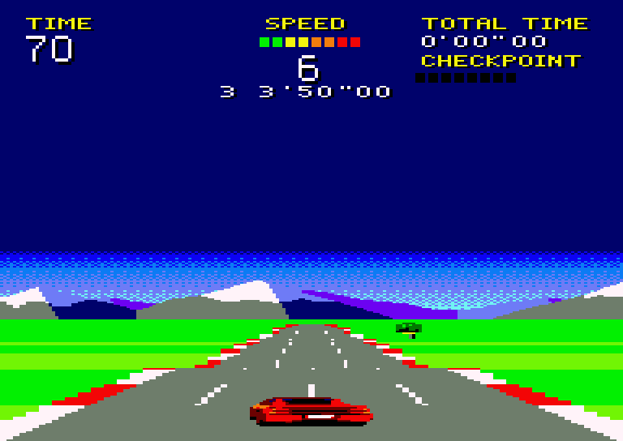 | 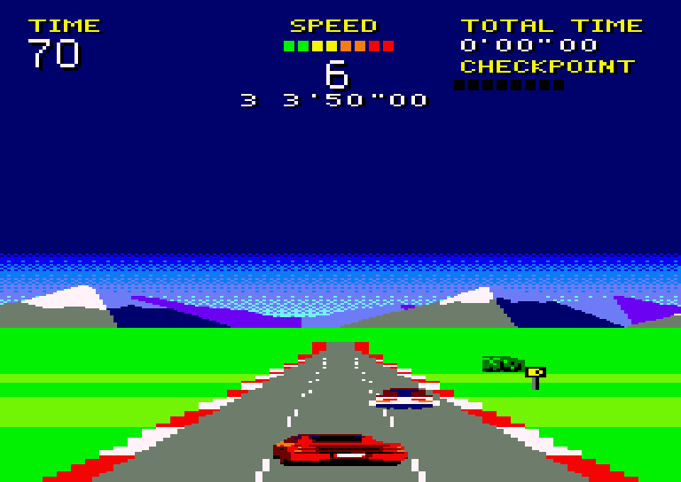 | 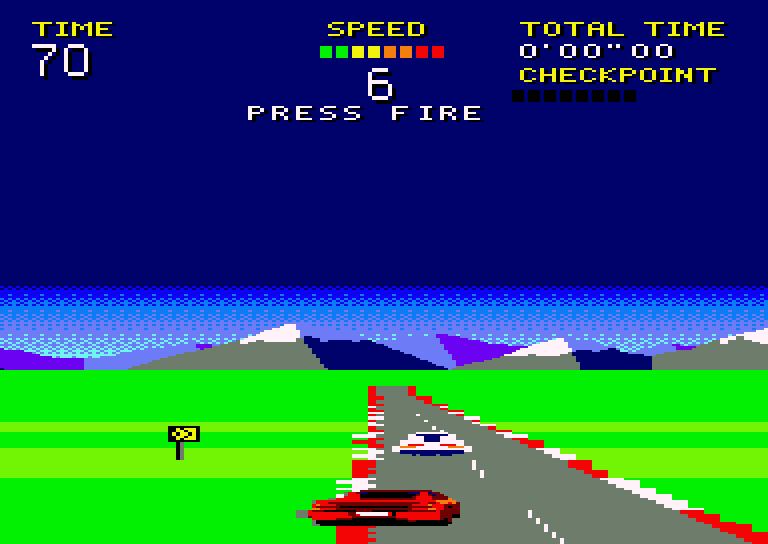 |

It has thick red and white kerbs. The asphalt is plain grey; the kerbs, the
lane dashes and, nearer, the grass are striped, in bands 64 depth units
long, the grass's 128. (From 2026-11-05 to 2026-11-07 they were half as
long, so that the road seemed to run by twice as fast with the car no
faster; at 1.5 times the speed - 2026-11-07 - the grass changed on more
lines than the pictures could draw whole, and a picture on a hill was late
now and then.) The dashes move all the way to the horizon: past the
striped zone they get longer with distance, so they don't flicker. The
road never narrows to a point: far away it is still 10 pixels wide, kerb
to kerb.

Bushes stand on the grass on either side, at random intervals, in three
sizes and at different distances from the road. They grow as they come
nearer, from 5 to 16 lines, and leave by the sides of the screen.

Up to two cars of traffic drive ahead in the lanes, slower than the player,
who catches up with them and drives by - or bumps into them. Now and then
one moves over into the lane next to it. Each
is a coupé with a sports car's or a saloon's tail, and a colour for its top
and one for its tail, out of fourteen: hundreds of different cars.

### The race

Fire pressed while the demo drives, GET READY: the road ahead flattens
out and straightens, the car brakes to a standstill in the third lane from
the left, the count goes 3, 2, 1 in the gear's place, and GO! - the player
drives, from a standstill. TIME starts at 53 seconds and counts down; TOTAL
TIME counts up. (Since 2026-11-07 every speed is half as much again as it
was, and the times three quarters - the races take about three quarters
of the time, as the bumps and the crashes take as long as they did: TIME
started at 70.)

A race is five stages of 12288 depth units each (about 27-33 seconds),
each with its own track and colours - the sky near the horizon, the haze,
the far mountains, the grass and the bushes. The first is always the
countryside; at the end of each of the others' predecessors the road
forks, as in the arcade: the HUD's message line shows the two stages that
can come next, the one on the left on its left and the other on its right
(`DESERT  RIVIERA`), and the car takes the one on the side of the road
it is on - left of the middle or on it, or right of it - as the track
past the checkpoint is worked out, 8 entries (0.7 s) before it. Sixteen
routes, nine stages:

| Stage | Left | Right |
|---|---|---|
| 1 | COUNTRYSIDE: curves and hills by turns; green and lime | |
| 2 | DESERT: long straights, big crests; sand, dark red rock | RIVIERA: the coast, sweeping and gentle; sea green, a cyan haze |
| 3 | SUMMIT: hill after hill; snow and ice | MESA: canyons, deep dips, sharp curves; orange rock, a pink haze |
| 4 | SUNSET: long sweeping curves; an orange and pink sky, dark grass | AUTUMN: winding over hills; lime and olive, orange bushes |
| 5 | NIGHT: winding; a dark sky, dark grass and navy | STORM: grey skies, hard curves |

| 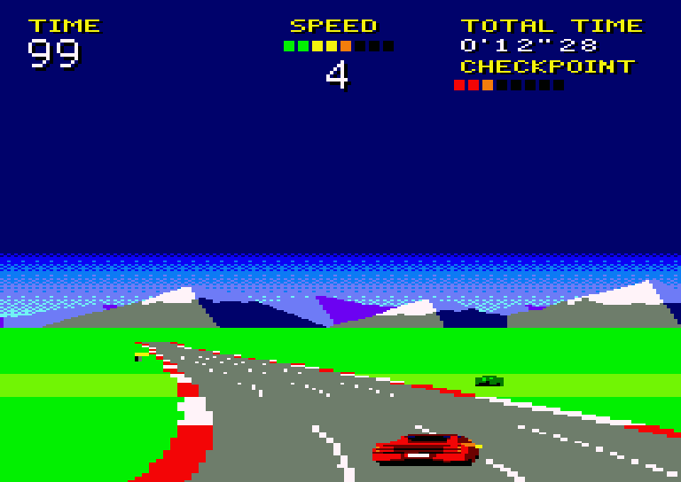 | 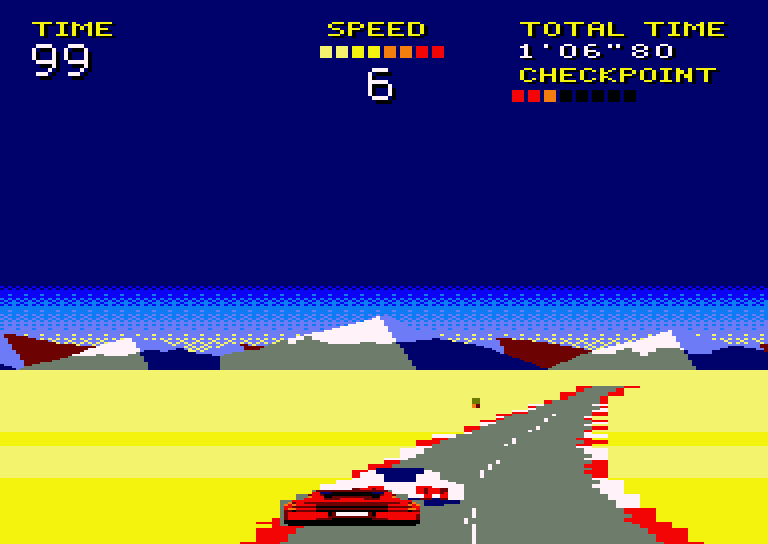 | 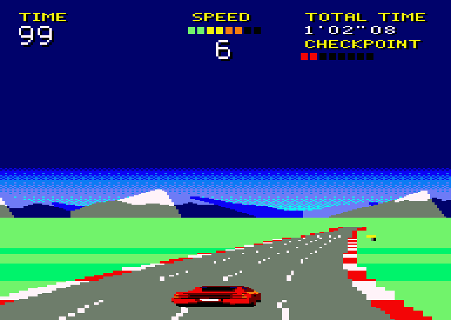 |
|---|---|---|
| 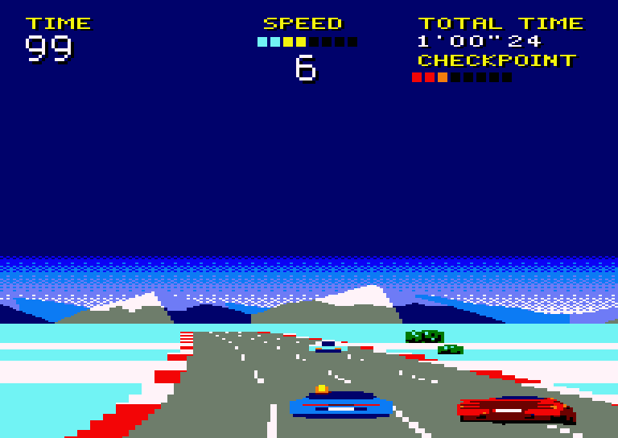 | 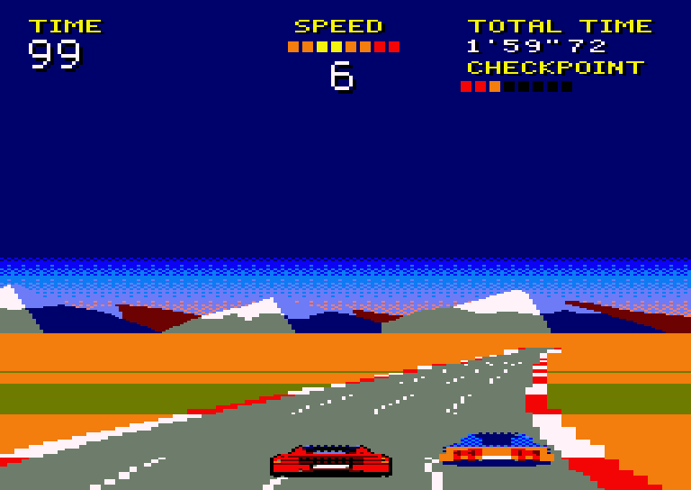 | 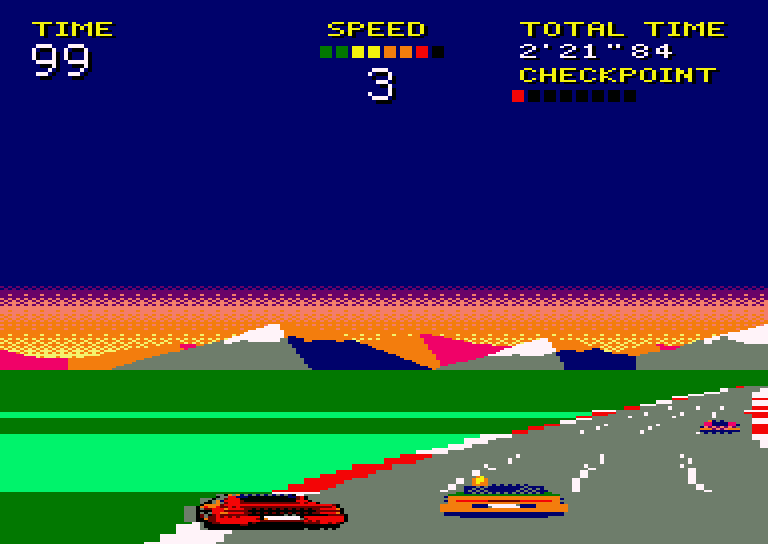 |
| 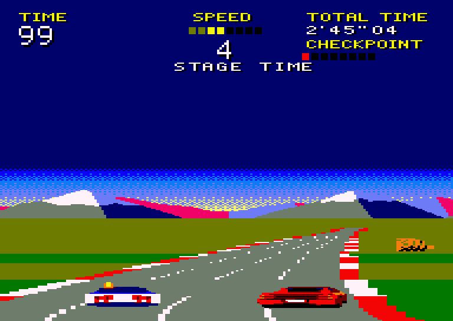 | 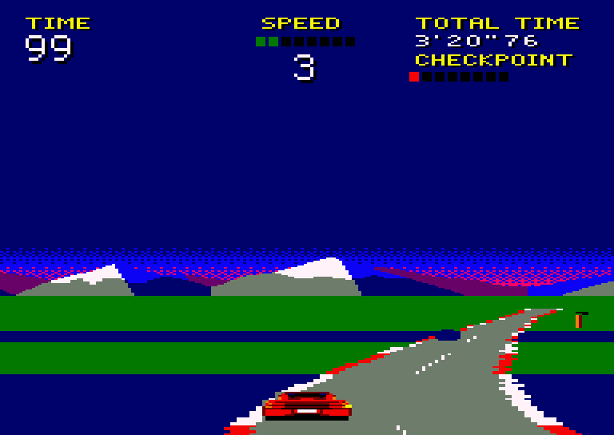 | 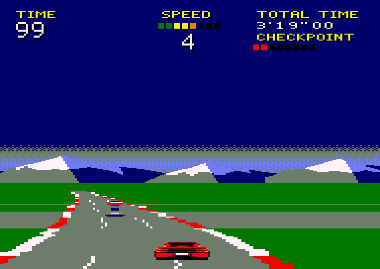 |

Beside the road, few and far between, stand each stage's trees - dead
trees in the countryside, on the summit and in the storm; tall thin
palms, short thick ones and dead trees in the desert; palms on the
riviera; dead trees and stumps in the mesa and the autumn; both palms at
sunset; tall palms at night - and before every sharp curve its signs
(Props, below).

The further on, the more traffic: in each next stage a car comes sooner
after the last one, and sooner on a fork's right than on its left. Two at
most are on the road at a time - about 1 on average in the first stage,
then 1.3, 1.6, 1.8-1.9 and 2 in the last (for the ROSSO GT, driven by the
autopilot; a slower car has more about it: 1.2 to 2 for the TOURING),
~18 cars coming a minute in the first and ~35 in the last (Traffic,
below).

The CHECKPOINT gauge fills on the way to each stage's end. There TIME gets
37 more seconds (EXTENDED TIME), 1 fewer at each next one, down to 27, and
never over 99; then the next stage's number shows, and its colours are
there at once. Past the fifth, FINISH: the car brakes to a standstill on
the straight that follows, and TOTAL TIME is the race's - FASTEST TIME!
once it stands, if no race has been faster (the best times, below). At
0, TIME UP:
the car brakes to a standstill, still steered, GAME OVER. Either way the
demo then drives on from there, its loop and its colours back after the
road has flattened out. (`rules_vbl` in `src/game.asm`; the numbers are
its `START_TIME`, `EXT_FIRST`, `EXT_DROP`, `EXT_MIN`; the stages are
`tools/course.py`.) The autopilot used for testing - keeping to a lane,
out of the traffic's way, often bumping it, never slowing down for a
curve - finishes, taking the left at every fork, with 28 seconds left in
the ROSSO GT, 31 in the BERLINETTA, 19 in the WEDGE TURBO and 25 in the
TOURING (34, 24, 15 and 10 before 2026-11-07, at two thirds of the speed;
with the times two thirds of what they were, as they were for a while
then, 5, 8, none and 9).

The messages - PRESS FIRE (blinking in the demo), GET READY, GO!, STAGE 1-5,
a fork's two stages, EXTENDED TIME, TIME UP, FINISH, FASTEST TIME!, GAME
OVER, PAUSE - are the HUD's last line (The HUD, below).

ESC holds the race - or the count before it, or the braking after it -
where it is: the picture stays, the sound stops, PAUSE shows; ESC again
and it goes on.

The five best times to the finish are kept as long as the machine is on:
in the demo the message line shows PRESS FIRE (5 seconds), then TOP TIMES
and each of the five - its place and its TOTAL TIME, 2'37"50 to 3'07"50
before any race has beaten them - 1.3 seconds each. A race that finishes
faster than one of them takes its place, the slower ones moving down; the
demo then starts with them, and its own blinks (`src/race.asm`).

The race has music - an original action tune, 16 bars in A minor at 150
beats a minute: a riff over a pedal note, then a chorus climbing the
chords' notes, the bass driving in eighths with an octave on the
backbeat - and the car its engine, from GET READY to GAME OVER: a note
from 65 Hz standing still to ~190 Hz at the top speed, humming, with a
rumble on the grass. The count beeps, GO! and a checkpoint ring, a bump
and a crash have their noise, TIME UP and FINISH their own few notes. M
turns the music off - the engine and the effects go on - or back on, from
the tune's start. The demo is silent, but for M's beep (Sound, below).

### The cars

Before the race the player picks one of four sports cars, seen from the
side on the screen the loader shows while the game loads - the title
screen too, COUNTRY RIDE above the cars and the credits below them
(`tools/mkselect.py`):


They are two wide red ones with a grille of black slats right across
their tails, after a Ferrari Testarossa - the BERLINETTA as it left the
factory, the ROSSO GT made new, with a lip on its tail and bigger rims - a
low yellow wedge with a louvred engine cover (WEDGE TURBO, after a Lotus
Esprit S2/S3) and a white estate with a spoiler over its rear window
(TOURING, after a BMW M3 Touring of 2022). 1-4 picks one and
starts; the arrow keys, O and P or the joystick move the flashing frame,
and fire, space or return start. Under them, E, M and H pick the difficulty -
EASY, MEDIUM (picked at first) or HARD, the one picked flashing: what
hitting a car costs (Collisions).

They drive differently - speed, acceleration and grip, shown as bars of
five (`scene.py` `CAR_LEVELS`; `car_setup` puts them into the code that
drives the car):

| | Speed | Acceleration | Grip |
|---|---|---|---|
| ROSSO GT | 5 | 4 | 3 |
| BERLINETTA | 5 | 5 | 2 |
| WEDGE TURBO | 4 | 3 | 5 |
| TOURING | 3 | 5 | 4 |

The first, the ROSSO GT, is Out Run's car (Steering, below), and the
others are as far from it as their bars (`scene.py`; `tools/mkdrive.py`
writes the numbers, `src/gen/drive.asm`). Speed 5 is the top speed of 9.8
depth units a VSYNC - Out Run's 293 km/h - 4 is 9.2, 3 is 8.5 (since
2026-11-07 half as much again as they were: 6.6, 6.1 and 5.7); on the sand,
3/4 of it, on the grass 2/5. Each car gets there as Out Run's does, scaled
to its top speed - LOW to 2/3 of it, from a standstill 1/3 in 3.6 s; changed
up at the best, 2/3 in 6.6 s, 85% in 9 s, 95% in 14 s and all of it in 24 -
each bar of acceleration from 4 15% quicker or slower (its `acc_tab`, a
table a gear, in its `CARn.BIN`). Grip is how fast the car is steered
across - at the full lock 0.8, 0.88, 0.97 or 1.06 pairs a picture with grip
2, 3, 4 or 5, 55% of Out Run's 1.6 (`scene.STEER_SCALE`: the user's "half
that speed" of 2026-11-10, then 10% more), 10% more or less a bar -
and how little a curve carries it out of it: Out Run's push, as hard as
its, 10% less a bar. So at the top speed a car holds only the gentlest
curves at the full lock, if any: the ROSSO GT levels 1-2 at any speed, 3
below ~240 km/h, 4 below ~180, 5 below ~135, 6 below ~115 and 7 below ~95.
(Till
2026-11-10 the cars drove by the user's own figures - a steady
acceleration, full speed in 4.9 to 7.8 s, half a pair or more to the full
lock, a gauge segment lost turning: git log.) On two lanes the curves are
gentler (The track, below): none sharper than level 5.


In the race the car is seen from behind, low down, 32 or 36 pixels wide
(40 or 44 till 2026-11-07, when every car - the player's and the traffic -
was made 20% narrower) and up to 26 lines high, a little above the bottom of the screen. Steering,
it is seen turning, OutRun's way: turning left, it turns about its rear
axle, its nose going left, the left flank and the hubs of its tyres in
view. Moving over to another lane - steered that way and going that way
on the road, not merely held in a curve - it blinks its indicator on that
side, as the traffic does.

The cars are photorealistic renders of 3D models (`tools/cars3d.py`, in
Blender with Cycles: paint under a clear coat, glass that mirrors the sky,
rubber, alloy rims, lenses lit from within, a sun behind and a sky). Their
bodies are curved: each is lofted along the car through rounded sections
(superellipses, from nearly square to round) whose width, height and
roundness follow smooth curves from the tail to the nose (`tools/car3d.py`
`Shape`, `loft`) - a rear face with rounded shoulders, hips over the rear
wheels and a waist at the doors, a bubble of a cabin with a painted roof,
sails, a nose rounded in plan and in profile - with the wheel arches cut
into them and fenders swelling over the wheels. Each is built to the
car it is after (since 2026-11-05): its length, its axles and tyres where
they are, its width along it, its profile and its rear's parts where the
drawings and photographs have them - laid over them in Blender's
orthographic views to check - the rear's parts then moved to the frame's
whole lines:

| Car | After | Drawn from |
|---|---|---|
| ROSSO GT, BERLINETTA | Ferrari Testarossa (4.49 m, axles 2.55 m apart) | a four-view drawing (getoutlines.com, CC BY 4.0), its height made the real 1.13 m |
| WEDGE TURBO | Lotus Esprit S2/S3 (4.19 m, 2.42 m) | a front, rear and side drawing (the-blueprints.com) and a top view of an Esprit Turbo HC (getoutlines.com, CC BY 4.0) |
| TOURING | BMW M3 Touring G81 (4.79 m, 2.86 m, 1.44 m high) | BMW's figures, its side in BMW's picture, its rear in photographs (Wikimedia Commons, CC BY-SA 4.0) - all of it 0.93 times, as tall as the frame takes |

The drawings and photographs themselves are not in the repository. The
ROSSO GT's picture is an image made by an AI (it was found as "Ferrari
Drago Rosso"), of no real car: from behind, where the race sees it, it is
a Testarossa. Each render is squeezed across to 0.8 of its width about
its middle (`mkcar.narrow`, `NARROW`: since 2026-11-07 the cars are 20%
narrower than their models; the dust of the spun views with them), then
brought to mode 0 in flat colours, with no dithering and no outline (since
2026-11-05; `tools/mkcars.py` `flat_pens`, `tools/dither.py`): each mode 0
pixel takes the mean colour of the render pixels of the car under it -
half of them at least, else it is clear - made more saturated and its
darks darker, and then the nearest of its car's pens: its paint's ramp
(dark red, red, orange, yellow, white), black, navy for the glass, and for
the white car pastel for its shade - never the asphalt's grey, which would
look like a hole, and no blues on the red and the yellow cars. On those
the paint greyed or blued by the sky's reflections, and the colours of
about its hue, are made its hue again, as bright (`repaint`): else the
reflections edged the cars in blue and lit red went orange. Each car has nine views - on the level, going
uphill and going downhill (pitched 8 degrees before the car is squashed as
low as the game draws it), each straight, turning left and turning right
(turned 6 degrees about the rear axle, `car3d.YAW` - 10 till 2026-11-10:
too much; the left view mirrored) - and two for a crash: spun 30 degrees about its
middle, its tail swung out (rendered in a frame 80 pixels wide, moved 4
pixels left to keep its box near the others'), with dust at its rear
wheels (white at the clouds' hearts, specks of it further out), and spun
the other way mirrored - in `tools/carsart.py` (`tools/mkcars.py`, which
also draws `build/cars-sheet.png`). In the race the car is seen uphill
where the road ahead climbs - the hill 20 or more into a dip - and
downhill where it falls away, over a crest (`car_lines`). On the level its
wheels stand on line 257 (`scene.CAR_GROUND`), 2 lines higher since
2026-11-05: a monitor's bottom edge hid its rear wheels (it stood 4
higher for a while).

On the select screen the cars are not their models' renders but pictures
of the cars they are modelled on (since 2026-11-04; `tools/mkselect.py`
`PHOTOS`, the pictures in `assets/cars/photo_*`, as downloaded):

| Car | Picture | Its rights |
|---|---|---|
| ROSSO GT | a red coupé made by an AI ("Ferrari Drago Rosso", posted on Facebook), a Google Images thumbnail the author gave | unknown |
| BERLINETTA | a Ferrari Testarossa drawn by charner1963 (Openclipart; Wikimedia Commons, `File:Ferrari_Testarossa.svg`) | CC0, public domain |
| WEDGE TURBO | a Lotus Esprit drawn by cactus cowboy (Openclipart; Wikimedia Commons, `File:Lotus_esprite.svg`) | CC0, public domain |
| TOURING | a BMW M3 Touring from BMW's configurator, the link the author gave | BMW's |

Each is cut out of its ground if it has one (the photo: its red paint's
columns, the lights at its nose, the wheels' discs), its lettering and
badges painted out, its glass made dark, its paint the race's car's (the
Lotus yellow, the BMW white), mirrored to face right, laid on the renders'
frame at its car's length, and dithered as the renders are, with the
select screen's own sixteen pens (pink for the red paint's highlights,
pastel cyan for the white car's and the glass's). Since 2026-11-05 the
race's models are built after the same cars (above).

## How it works

### Frames

There are two screen buffers. The game draws into the one not on screen. The
interrupt handler (IM 1) shows the new buffer at a VSYNC at least two frames
after the last flip, which gives a steady 25 Hz. The game logic steps at
50 Hz. If a picture is late, it catches up by up to four steps.

### The split screen

The picture is three parts, each in its own memory:

| Part | Lines on the flat | Memory |
|---|---|---|
| HUD | 0–63, then navy border to 131 | page 1, one copy per buffer |
| sky and mountains | 132–179 (navy to 135) | page 3, one copy for both buffers, in a ring |
| road | 184–271 (180–183 are border) | page 2 (buffer 0) or page 0 (buffer 1), from line 160: 160–183 never shown |

The interrupt handler reprograms the CRTC three times a frame (raster
ruptures), so every frame is three CRTC frames with their own start address,
row count and R5 lines.

- **Horizon drop.** When the road's top is *d* lines down, the sky goes
  *s* lines down: twice *d*, but no further than the road part's first line
  less one, and at most 2 more than for *d* − 1 (`scene.sky_drop`, a table
  in the interrupt handler, with the 68 lines from the HUD to the sky part
  added). The HUD part ends in navy border: its last row (navy anyway),
  (68 + *s*)/8 more rows, all hidden by R6, then (68 + *s*) mod 8 R5 lines -
  4 on the flat. So the sky starts at line 132 + *s*.
- **Road start.** The road part starts at the character row the road's top
  is in. Between the two parts is green border (a row if needed, then R5
  lines), so the road lines are always where they are in memory, and the
  road renderer knows nothing about any of it.
- **R5 lines.** CRTCs differ in them: some make them border after the last
  row, others keep showing the next row (Retro Virtual Machine did, as dashes
  under the HUD and a black bar under the mountains). So they are fewer than
  8, the HUD part's come after a border row, and the ring row after the sky
  part's last is kept green, the colour of the border there.
- **When registers are written.** A part's start address is set in the part
  before it, never in a part's first row (type 1 rereads it on every line
  there); a part's size is set while it, or the R5 lines just before it, are
  on screen; R6 only well before or after the row it names.
- **Sky ring.** With MA10/MA11 at 0, the CRTC's address wraps every 1024
  characters (2K). The sky part is 6 rows of 48 characters in that ring.
  Moving its start address one character scrolls it a word (4 pixels)
  sideways for good; only the column that comes in has to be written, from
  the panorama (384 pixels in bank 7: per column of a word, its four
  character rows' numbers, each row - 16 bytes, two a line - kept once:
  150 different ones of 384, the sky and the mountains' bodies being many
  columns'; 2.8K instead of 6K). That takes
  ~1.4 ms, done at the flip, before the sky part is on screen, so it never
  tears. The dithered sky repeats every word, so only the mountains seem to
  move.
- **Timing.** The Gate Array interrupts come at fixed lines (~274, 14, 66,
  118, 170, 222), and each handler sets up the next one's, so none has to
  work out where the frame is. Each register is written with more than five
  lines to spare. The HUD part's rows run on to line 131 or further, so the
  sky part's size waits for the interrupt at ~170, in the sky part. The VSYNC's handler checks that it is in VSYNC; if a frame
  is ever out of step, the handler falls back to a plain frame until the
  next VSYNC.

### The loader

`disc/country.bas` (`RUN"COUNTRY`) sets `MEMORY &18FF`, puts the select
screen at `&C000` (the title and the cars, `tools/mkselect.py`, "LOADING" in
pen 14), then the cars' turning (The cars turning, below): `SPINA.BIN` to
`SPIND.BIN` into banks 4-7 and `SPINE.BIN` into base memory, each at `&4000`
with its memory switched in there, and `SPIN.BIN` at `&9C00`
(`SPIN_CODE`), which it calls: the cars turn. Then it inks "LOADING"
out and the keys' line in,
draws the picked car's frame in pen 13 (flashing, `INK 13,24,15`; the
others' in pen 2) with `DRAWR`, and prints the difficulties where "LOADING"
was: the small font's letters as characters 240-249 (`SYMBOL`), with `TAG`
at the graphics cursor, a letter at a time, each key in pen 15, each word in
pen 3 (the credits' sky blue) and the one picked in 13. When the car is
picked it stops the turning (`CALL &9C03`), inks the keys' line out, and
loads the game over it: each of `ROADA.BIN`, `ROADBn.BIN` (the picked
car's: bank 5 with its views rolling over, below), `ROADC.BIN` and
`GAME.BIN` at `&4000` with its bank (4-7) switched in there, `SOUND.BIN` at
`&98C0` and `RACE.BIN` at `&A0C0` - every file packed (below) - while the
screen stays, the picked car's frame flashing; then it puts its `CARn.BIN`
at `&1900` (`CAR_BLOB`), POKEs the difficulty into it (`&1906`,
`CAR_DIFF`: its first record's byte, 32 a step, which `boot_car` puts in
`coll_diff`), and puts `BOOT.BIN` at `&4000` and calls it.

Since 2026-11-10 every file but the loader is on the disc packed (ZX0, by
rasm's own cruncher: `LZX0`). `src/main.asm` writes the files as they go in
memory, `build/<name>.raw`; `src/pack.asm` packs each behind the word where
it goes and writes the disc; `tools/zx0check.py` unpacks each again (a ZX0
decoder after the format's reference one) and checks it byte for byte, and
that it fits where it is loaded - in `make`. `SELECT.BIN`, loaded at `&4000`
and called, copies the unpacker (`src/dzx0.asm`, rasm's `dzx0_standard`: 68
bytes, the main registers and the stack only, so the firmware's interrupts
run on) to `&A600` - past `RACE.BIN`'s place, before the 6128's characters
240-255 - and unpacks the screen. Then the loader loads each file at `&8000`
and calls `&A600`, or - the car's and `BOOT.BIN`, which would reach the
sound and the race - at `&C000`, once the screen is black, and calls
`&A605` (`src/discmap.asm`). 119,230 bytes go on the disc as 42,999 (36%):
the screen 22%, the banks 22-31%, the game 59%, `BOOT.BIN` 45%, the cars
about 41%, the sound and the race 82-88%. The disc has 51K on it, not 128K,
and from `RUN"COUNTRY` the select screen was ready in 16.5 s, not 21.0, and
the race showed 5.4 s after the car was picked, not 6.6 (the emulator; each
file still costs 1-2 s to find, however small). Since 2026-11-10 the cars
turn on it: 72,078 bytes more go on the disc as 46,876 (65%), the select
screen and the cars turning there in 21 s, the race 19.5 s after the car is
picked.

It has no room for more. BASIC loads nothing under `HIMEM` ("Memory full"),
so `HIMEM` stays under `CAR_BLOB`, the lowest file; and its first file takes
4K under `HIMEM` for its buffers. So the program, its variables and those
4K share `&0170-&18FF`: `FRE(0)` after `MEMORY &18FF` was 4233 bytes (some
60 to spare), 2843 with the difficulties written as the other lines were -
"Memory full". So the loader's notes are here, not in `REM`s, and the
letters (7 lines each) and the words (each letter's number and pixel) are
in the select screen's hidden bytes, the last 48 of its first three 2K
blocks, read with `PEEK`: 4473 free then, 4419 with the files unpacked.

### The cars turning

While the player picks a car, the four cars turn round on the select screen,
each in its panel between its name and its bars, all four together: a view
every 15 degrees, a turn in 3 seconds (`src/spin.asm`, since 2026-11-10).
Each car's 24 views are its model (`tools/cars3d.py`'s, photoreal) rendered
by `tools/spin3d.py` - seen from its side by a camera 5 degrees above, the
sun with the camera, 14 mode 0 pixels a metre (its side about 64 pixels, as
the pictures were), heights times 0.8 - and brought to the screen's own pens
as `mkselect.py` brings its pictures (`dither.py`, black outlines), in
`assets/cars/spin_<car>.png`. `tools/mkspin.py` makes from them what is
played: what each view changes on the screen (`src/gen/select.scr` with the
views on it), a stream of tokens for the player, and before them a stream
per car that puts its view 0 over its side picture. They are played there
too and checked against the views, byte for byte, through two turns.

The player is a page of code that the tokens jump into (each token the low
byte of where it jumps, in `IX`): n bytes as they are into a chain of `LDI`
(n from its end), n times the byte in `A` into a chain of `LD (DE),A : INC E`
(the runs cut before `E` wraps), the byte for `A`, an address, the end - no
loop, no count: 5 microseconds a byte as it is, 3 a run's byte. The streams
are 72,078 bytes (about 720 a car's view: as it turns, most of a car
changes), in five areas - banks 4-7 and base memory at `#4000`, each
switched in there while one of its streams plays - each as much as packs into
what the loader can load at `PACK_LOW`. They take the memory the game's
files take, so the game is loaded once the car is picked (The loader).

It runs from the interrupt itself, BASIC's menu going on above it: the 6128
firmware's interrupt entry in RAM (`#B941`, where `#0038` jumps from RAM
and from the lower ROM alike) jumps to it first, its first three bytes
done after it, until it is stopped. The firmware's frame flyback events come
too late for it whenever BASIC keeps the firmware busy (the flashing ink,
the keyboard), and `#0038` alone is passed by while the lower ROM is in.
The interrupt in the VSYNC counts the frames, and a view is played in two
halves timed to the beam from the VSYNC's end (line 248 of the frame, the
screen's lines at 0-199), the interrupts off: the top cars from 8.9 ms on
(the beam past their area, lines 31-66, at 8.4 ms), done by 19.2 ms, long
before the beam is back at them; then, from the next VSYNC's end, the bottom
cars at once, done by 10.3 ms (the beam at their area, line 110, at 11.1
ms) - and a wait so that it ends at 10.35 ms whatever they took. That last
matters: the interrupts held off are taken late, which moves the gate
array's count, and its interrupt at the VSYNC only comes if none came in
the 32 lines before it; ending there, the next ones come at lines 97, 149
and 201, and the VSYNC's at 242 does. `mkspin.py` works the times out from
what each stream takes, microsecond by microsecond. So all four show in the
same frame, and no car is ever seen half drawn (checked in the emulator:
each panel shows only the 24 views, through two turns). Every fourth view
stays a frame more: 24 views in 150 frames.

### Memory

The CRTC always reads the base 64K:

| Page | Holds |
|---|---|
| 0 | buffer 1's road part, common fragments; the sound in hidden lines |
| 1 | both HUDs (`#4000` with RAM C1), the bush sprites' code and the props' sprites beside them |
| 2 | buffer 0's road part, common fragments; the sound in hidden lines |
| 3 | the sky ring (`#4000` with RAM C3) |

The banks hold the rest:

| Bank | Contents | Seen at |
|---|---|---|
| 4 | for stripe band A: the cache's templates (`#4000`, the ground's first), road code (`#4200`), the lanes' code and band A's tables for three and two lanes (0.9K free after them) and the next step's staging set (`#7E00`) | `#4000` (C4) |
| 5 | for stripe band B: road code (`#4000`), the next step's staging set (`#5E00`), the cache's templates (`#6000`) and per group arrays (`#6200`, a page each; the lanes' widths and depths under the first three, 205 bytes under each of the others), band B's tables for three and two lanes and the lanes' code (1.5K free after them) | `#4000` (C5) |
| 6 | the road's row tables and the precomputed hill tables; the traffic: its code, tables and most of its sprites' code | `#4000` (C6) |
| 7 | the game (main loop, HUD, graphics, the panorama, the track's rings and the props' size table at `#F000`, over what runs once at the start) | `#C000` (C1/C3) |

Some code and data must be reachable from every RAM configuration: the
variables they share, the interrupt handler, the stack, the line lists and
the part of the renderer that switches banks. These live in 704-byte
fragments at `#x540–#x7FF` of pages 0 and 2, beside the road parts: the
eight in page 0 (the first also has the props' drawing, cut to fit the
screen: there was the IM 2 table, 263 bytes - IM 1's `JP` is at `#0038`,
in a hidden line), and the eight in page 2 hold the bushes' tables and
their sprites as data (and, in what is left, some of the car's and the
traffic's code). `src/hw.asm` has the whole map. Bank 7's code that runs
only once, as the game starts (`src/init.asm`: the car's figures, the
parts of the screen that never change), is at `#F000`, where the track's
rings and the props' table are worked out after it.

The car's code - a compiled sprite for each of its eleven views - has the
same places for every car, as big as the biggest car's needs
(`tools/mkbush.py`): the three on the level in page 1 beside the bushes'
and in what is left of the page 2 fragments (with the smallest bush's code
when page 1 is short), the six on hills and the two spun (6.4K) in what
the CRTC never shows and nothing else writes: the HUDs' eighth character
rows (the HUD part shows seven: `R6`), bank 7 from `#F100`, after the game, and the road
parts' lines 160-172 - buffer 0's, and buffer 1's first four 2K blocks (a
bush reaches line 173 at most, the line lists start at 188, and
`draw_static` fills only from 184). BOOT.BIN has the first car's views on
the level in place. The loader loads the picked car's own `CARn.BIN` at
`#1900` (just past buffer 1's hidden lines in its fourth 2K block, which
take code) - records of where they go and the bytes: its code, `car_views`
(where each view's first line ends, and its code), `car_id` - and, the
same in every one, the traffic's code and the props' sprites that have no
room elsewhere. BOOT.BIN
first puts the fragments in place - but 3-6, whose places the file lies
on - then copies the records into place, with bank 7 switched in, and then
fragments 3-6. The race takes no more memory for four cars than for one.

Each car's six views rolling over (since 2026-11-12, 3.25-3.47K a car) are
most of them in bank 5, which the car's code runs with only there (`RAM_C5`):
under each of its per group arrays but the first three (205 bytes each,
under the other 13), and past the bank's code (`ROLL5_TAIL`, `#7D00`, to
`SB`) - 3382 bytes nothing writes in a race. So bank 5's file is a car's
too: `ROADB0.BIN`-`ROADB3.BIN`, each main.asm's bank 5 (`build/roadb.raw`)
with that car's views in that room (`build/roll5_<n>.raw`, `gen/roll5.asm`)
- `gen/roadbn.asm` in `src/pack.asm` puts each together, with `INCBIN`s
of each in turn. What does not fit there (up to 142 bytes) goes in the
hidden lines the views on hills leave in pages 0 and 2, with each view's
way in (`RAM_C5`, then into bank 5) and `roll_done` (`RAM_C1` again, for
`bush_spr_done`): `CARn.BIN`'s records (`tools/mkbush.py` `roll_place`).

The sound (`SOUND.BIN`, records like a car's file, unpacked at `#98C0` - in
buffer 0's fourth block, past what the car's records write - and put in
place after them) is where nothing else goes: what the interrupt runs and
reads in the road parts' lines 173-178, both buffers' (eleven of their
twelve 96-byte pieces - buffer 0's line 174 has the crash's jump - in
pages 0 and 2: whatever the RAM configuration; a bush's top is
on line 183 at the highest, a prop's on 179, both checked by
`tools/mkbush.py`); what the main loop runs is in `RACE.BIN` (below).
`SOUND.BIN` has the HUD's words too, as masks with the code that draws
them (`src/labels.asm`), put in buffer 1's road lines 194-258, which
nothing draws until the first picture (and, after them, TOTAL TIME's `'`
and `"` from `RACE.BIN`).
`boot_blob` (`src/boot.asm`) copies both files' records. `RACE.BIN` (the
pause and the best times, and the start of a race, which bank 7 had no
room left for: `src/race.asm`) is records too, unpacked at `#A0C0` and put
in place after the sound: in buffer 1's hidden lines 164 and 172 (which
the traffic's code leaves), 167, and 178 - `stage_id` among them, where
the traffic's code (RAM C6) reads it too. It has the sound's main-loop
side too (`src/sndgame.asm`), in four HUD eighth rows - the fourth,
`#4DA0`, where `boot_car` itself was: `RACE.BIN` is its last file, and
`boot_blob` returns from it for it - and a hidden line of page 0; and the
crash's jump (`src/jump.asm`), in buffer 0's line 174 and what the
sound's main-loop pieces leave free at their ends (`REC_TAIL`).

Page 1 has the HUDs in the first `#600` bytes of each 2K block - but the
eighth character row of each, never shown, holds code of the car's views
on hills: 12 runs of 96 bytes, those BOOT.BIN's own fragments have left
by then (`tools/mkbush.py` `HUD_ROW7`); the other
512 bytes of each block hold the bush sprites and the car as code, and most
of the props' sprites as data - the
seventh block's first half, at `#7600`, the keys and the player's speed
(`src/player.asm`), and the last block's first half, at `#7E00`, the part
of the road cache's work that runs with RAM C1.
`BOOT.BIN` is unpacked at `#4000`, so it carries that code where it runs, and
the fragments, which it copies out, two to a block where the HUDs go later.

### The road

The road is made of 80 rows (its shape is laid out over 84, as if it went
on to the screen's last line). Each row has a depth, and its stripe band is a
bit of (depth + camera position): bit 6, a band 64 depth units long, and
the grass's bit 7. (With the bands half as long the road code had both
doubled, `STRIPE_K` 2 - `rp_zsets` - so that in their low bytes the bits
stayed where they are.) For every row width, band and pixel parity,
`tools/mkroad.py` generates straight-line code that draws the row with
`PUSH` instructions:

- the asphalt and the kerbs come from registers;
- everything else comes from `LD BC,nn / PUSH BC`;
- at an odd byte the code covers a byte more either side, the grass: from
  the grass's register, the other byte of its pair as `LD C,n` (or `LD
  B,n`) puts it (since 2026-11-07; till then kerb, and the kerb's outer
  edge stepped 4 pixels at a time, its inner one 2, so that the kerbs
  looked jagged);
- the grass is shared blocks of 48 pushes, entered part-way.

A *template* says how to draw a row: where to enter the code, how much grass
goes on each side, and how to cut the code short where it leaves the screen.

Each frame:

1. `road_project` writes, for every road line, a pointer to a template into
   a line list.
2. `road_draw` walks the list with the stack pointer, jumping into the
   generated code for each line.
3. Lines that cannot have changed are skipped: the ground behind a crest,
   and far lines whose dash has not moved - told from the bit of
   (depth + camera) the dash is, now and when the buffer was last drawn. The
   list ends after the last line that changed.
4. The grass changes colour only where its stripe moves, so a line that
   shows the same row at the same curve level as when its buffer was last
   drawn, in the grass's stripe it was in, gets only its road drawn, kerb to
   kerb, and its grass is left alone. Bit 0 of the template
   pointer says so (templates sit at even addresses). If the hill has moved,
   `road_project` compares each line's row with the old hill level's; on a
   straight road a line that now shows a nearer row needs only its road
   too, as the old, narrower road lies under the new one. A line that
   shows the row it did, in the stripe it was in, is already right and is
   skipped - with the hill alone having moved, as when nothing has (on a
   crest or in a dip most near lines show the row they did).

Hills move row *r* down (on a crest) or up (in a dip) by *h / r* lines, with
occlusion behind a crest. The line-to-row mapping is precomputed for 128 hill
levels, so a hill costs nothing extra per frame - 80 tables of 80 bytes:
levels that are the same share one (the strongest crests are all the
road top's limit, `HILL_MAX`), and the dips deeper than the course's
deepest share that one's (`tools/mkroad.py`; 3.8K less since 2026-11-05,
where the traffic's sprite code now fits whole).

### The track

The game reads the track an entry - 32 depth units - at a time: the hill
and the curve level under the camera, and a few entries on (whether a hill
is near, the next curve level to work out). Those come from two rings of
64 entries in bank 7 (`#F000`), which `course_fill` keeps worked out 8
entries ahead of the camera from a list of segments: n entries straight,
a curve to level v and back, one level an entry, or a hill of height v,
a sine from a quarter-sine table. Two bytes a segment: the demo's loop is
18 of them (`course_demo`), the race's nine stages 14 to 21 each
(`course_st0`..). A segment `0, 16 + n` has the road's lanes n (4, 3 or
2) from there on (`lane_ask`, below). Any list can follow from the next
entry on, after the
road is first brought to the flat - a curve level and 12 of hill an entry
- so the race starts on a straight wherever the demo was, and the demo
takes its loop up again wherever the race ended. A stage's list ends at
its fork: the next stage's list follows at once (each starts and ends on
a straight), the left one or the right one as the car is then
(`stage_fork`), with its props (`stage_lists`); past the fifth, the
finish's straight. `tools/course.py` has the lists and the
model of all this, to the bit, and makes sure the road never bends on a
hill - and that a hill comes 12 entries or more after a curve: the road can still be a level or two into the curve there, and a
picture with the road bent on a hill that moves is the heaviest there is
(with 6 entries, 39.9 ms).

The lanes (`L` in `tools/course.py`): the demo's loop has four, then three,
then two; the stages begin with their own - four in the countryside and at
sunset, two in the desert, at the summit and at night, three elsewhere -
and five of them change half way (`src/lanes5.asm`). There is no curve
from 24 entries before an `L` to 28 after it (`check_lanes`), as the
lanes change with no step worked out ahead (below) - and in the race no
hill either: the road can still be a level into the curve before, and
bent on a hill that moves, with a jump, the change's bit more made a
picture late. On two lanes, half as wide as four, a curve has half the
room to carry the car out, so each is two levels gentler than written
(`gentle`: 7 is 5, 6 is 4, 5 and 4 are 3, not below 3) - at their top
speeds the first two cars are carried out at most 0.9 and 1.4 times the
road's room there with the full lock held (2.0 and 2.9 before), about as
on three lanes, and the other two hold every curve of two lanes.

### Lanes

With three lanes or two the road is three quarters or half as wide
(`cpcgfx.lane_half`), each lane as wide as four's; band 0's cores (the
only ones with lane lines) are made for each count (`tools/mkroad.py`:
bands 3 and 4 - with three, two lines at the whole bytes nearest a third
of the asphalt either side of the middle; with two, the middle one alone),
band B's and band 2's are the four lanes' of the narrower width. Each
template group has its own lanes (`RA_LN`, bank 5) and the tables that
make its templates (`rd_t5`, `rd_t4`) its own count's (from `rd_s5_<n>`,
`rd_s4_<n>`).

A change is asked for by the track (`lane_ask`: 768 depth units on,
`lane_z`), and goes in group by group from the furthest, as the road
comes: a group takes the new lanes when its furthest row is past `lane_z`
(`lane_dl`, `lane_dh`) - or up to 64 units before, in the time left before
a flip (`lane_can`: up to 5 groups) - and otherwise before `road_project`
(`lane_must`: one a picture, ~0.4-0.8 ms). Its width `H` (`lane_hs`) and so its sum `A'` and
its place `a` move as far as its core's edge does (its shift and its
share of `road_x` stay: they go by its depth), its tables are copied
(`LANE_COPY`), its templates made afresh (`lanes5.asm`, `lanes.asm`), and
both buffers draw its rows whole next (`lane_ghi`, `lane_glo`;
`rp_lane_whole`, and every far line if it has far rows). With the road
two widths, a hill that moves can also take a line from one side of the
change's reach to the other - a nearer row is then the narrower, or a further
one far narrower than a margin allows for - so those lines are drawn whole
too (`rp_lane_hill`; only the demo, the race has no hills there). The rows past
`lane_z` at the start (the furthest five) change at once; the rest follow
over ~950 units, a few groups a picture near the car at speed. Meanwhile
no step is worked out ahead - one is dropped first (`lane_pre`) - so steps
go there and then; a curve level the road has still to take goes on, and
the groups wait for it. A change asked for while one goes on
follows it. The car is on the grass from 5 a lane either way
(`lane_road`), and the demo steers that much narrower. `tools/scene.py`
draws each row as wide as its group's lanes (`road_lines`, from `RA_LN`),
and `run.py check` holds the two to it.

### Curves

A curve has a level from −7 (sharp left) to +7 (sharp right). At level *k*,
row *r* moves sideways by *k*/7 × 64 × ((84 − *r*)/83)² bytes: a parabola,
nothing at the screen's bottom and 128 pixels at the horizon at the
sharpest. Moving
a row only changes its template: the grass on each side, where the code is
entered or cut short, and, for an odd number of bytes, the code for the
other pixel parity.

So the road is drawn from one set of templates in each band, 512 bytes,
made for the curve level and the road's place (the cache, below): band
A's in bank 4 and band B's at the same offsets in bank 5, next to the code
they point at; `road_draw` tells which bank a template is in from bit 13 of
its address and switches before reading it. A curve costs nothing per
line. (Till 2026-11-05 `tools/mkroad.py` also made a set for each of the
15 levels, with the road in the middle, drawn there: 15K of banks 4 and 5,
now free.)

Far away, a row moves a lot from row to row, so the 7 furthest rows have a
template each; nearer, the rows of one width share one.

A buffer's level moves at most one level a picture. When it moves, the road
has moved sideways by at most 5 pairs of bytes on any line, so each line is
drawn with its road and 5 pairs of grass either side of it, not whole. That
picture has a smaller HUD share and leaves the sky's turn to the next one,
and a picture that starts with the sky turning keeps its buffer's level for
one more picture, so the two never fall on the same picture.

### Steering

The car is driven as Out Run's - the SMS's, as OutrunOutrunCPC runs it
(its `tools/native/LOGIC.md`: the engine `L2F6B`, the steering `L264D`):
`tools/outrun.py` models it and works out ours, the first car's Out Run's
own (the others: Picking a car, above). Out Run runs 12 loops a second; a
unit across its road is 20/108 pairs (its road's edge, 108 from the
middle, our `OFFROAD_X`); its 293 km/h our top speed of 9.8.

- **The engine.** Out Run's revs, torque curve and two gears the player
  changes (`drive_gear`: up LOW, down HIGH): LOW to 193 km/h - 100 in 3.6
  s, 160 in 5.4, 193 in 11.4 from a standstill - and HIGH to 293 - 100 in
  4.8 s, 193 in 10.4, 250 in 12.7; changed up at 160, the best (the demo
  does: `SHIFT_SPEED`), 193 in 6.6 s, 250 in 9.0, 280 in 13.7 and 293 in
  23.6. The speed gained a VSYNC by the speed, a table a gear (`acc_tab`,
  `speed_acc`, sixteenths). With neither the pedal nor the brake held the
  car loses 48 km/h a second (`SPEED_COAST`), braking 164 (`SPEED_BRK`);
  changed down to LOW over its top it slows to it 48 a second. Off the
  road the pedal gives less: on the sand (Out Run's 40 units, 7 pairs) HIGH
  221 km/h at most (LOW its 193), on the grass past it LOW 117 and HIGH 88
  (`sp_caps`, each car's of its top; `speed_player`, `off_cls`).
- **The wheel.** Left or right turns it (`steer_s`) towards the full lock,
  neither brings it back, 31 of 127 a picture at most: 0.17 s to the full
  lock (Out Run: 64 a loop). At the full lock the car moves 1.6 pairs (6.4
  pixels) a picture - Out Run's 18 units a loop - from 128 km/h on, or off
  the road (since 2026-11-10 less: 0.88 pairs, 55%, `scene.STEER_SCALE`,
  the user finding Out Run's too quick to turn and change lanes); on it,
  slower, as much less (`STEER_SPEED`), not at all
  standing still. In a curve of level 5-7 above 147 km/h less, by the
  level and the speed (`sharp_tab`: Out Run's bends under radius 64): at
  the top speed 1%, 18% and 29% less.
- **The curves.** A curve level *L* stands for a bend of radius 45 × 7 /
  *L* - the curvature with the level, level 7 Out Run's sharpest (its bends
  are radius 45-90, mostly 50-63: our 5 and 6) - and carries the car out of
  it as Out Run's does, the speed × *k* / 220 units a loop, *k* = 1091 / *r*
  - 1 (`push_levels`: 7, 7, 9, 12, 16, 19, 23): on a level 7 curve at full
  speed 2.72 pairs a picture, 170% of Out Run's full lock (310% of ours). The push comes and
  goes, 0.21 pairs a picture each picture at most (Out Run: 5 units a loop).

The two moves add up in `car_x` and its fraction `car_xf`
(`steer` in `src/game.asm`). The car moves across the screen at once, and
the road - the camera - follows
it as fast as its steps go: the car is drawn `road_x` - `car_x` pairs right
of the middle of the screen, 8 at most (`CAR_LEAD`; the road at most 8
pairs behind - 16 till 2026-11-12: nearer the middle now, the steering
across 10% slower when the road's steps are held back). The road moves under it in perspective: `road_x` is how many
pairs (4 pixels) right of the middle the road is on the bottom row, and a row of half-width *h* bytes moves `road_x`
× 10*h*/256 bytes - the far road hardly moves, and the road turns about the
horizon. `road_project` takes its templates from a set in each bank, the
cache, made for the curve level and `road_x` (`src/cache.asm`).

- **Smooth edges.** Each group of rows keeps one sum - its curve level's
  shift and its share of `road_x`, in 1/256 bytes - and is drawn at the
  byte that sum rounds to (`cpcgfx.road_shift`). Rounded as it is,
  neighbouring groups would step at different moments and the kerbs and
  lane lines would zig-zag; so a small bias, at most a quarter of a byte,
  turned round from one group to the next and following the edge's slope,
  moves where each one rounds, and the edges come out as even staircases.
  The lane lines sit at an even number of pixels from the centre.
- **A step sideways** (`cache_step`) moves every group's sum two or four
  pairs' worth (8 or 16 pixels: `road_x` is always even, and with the road
  to go a pair it waits), between two pictures, so none shows the road half moved. The groups whose byte changes - about 40 of 51 - get their
  templates made afresh: band B's in bank 5 there and then, band A's and
  the far rows' band 2 in bank 4 after, from a list of the groups that
  moved. A core all on the screen takes its template straight from per
  group tables; one cut short by a side of the screen has the pair it is
  entered at or left by looked up in its entry table (every core variant
  sits in one 256-byte page, so that is all low bytes). Made there and
  then, a step takes ~12.5 ms (up to ~15 ms with the road 8 pairs or more
  to the side a sharp curve bends to).
- **Worked out ahead.** So the next step - up to four pairs towards where
  the road is to go (`cp_pend`) - is worked out in the time left before each flip, a
  piece at a time (`cache_pre`: up to 12 groups or 7 band A templates,
  ~2.4 ms, up to ~2.8 ms), when no new curve level is to be worked out
  first (below).
  Its templates go into a staging set in each bank, laid out as the cache
  set, and the bushes' shares into a staging table; the groups' sums move
  there and then, and are put back if the step is dropped (the road to go
  the other way, or less far; a new curve level). The step itself only
  copies the staging sets into the cache sets: ~5 ms, so it can go after
  any picture done by the 10th interrupt. The staging sets are then the
  cache's, so the next one starts at once; after a step made there and
  then they are made the cache's again first (two pieces).
- **Only when it fits.** A step made there and then - when none is worked
  out ahead, and two pairs at most - is made after a picture only if it is
  sure to be done before
  the flip, by the interrupts counted since the last one: up to the 6th (the
  5th on the costly side of a sharp curve); one worked out ahead, whenever
  there is a step at all. Else the road waits a
  picture. After a step the next picture of each buffer draws every near
  line's road and a margin of grass, and the far lines too unless the step
  left every far group where it was. A step goes on a hill too: with the
  road 80 lines high, a picture whose hill moves and road moved sideways
  fits (37.4 ms at worst). With 105 lines it did not - a step on top of one
  made it late - so until 2026-10-26 nothing moved after a picture whose
  hill moved, nor while a hill was under the camera or two track entries
  ahead, and on each hill the road did not follow the steering for up to
  4 seconds.
- **A new curve level** is worked out ahead the same way,
  into the staging sets (`cache_want`, `prk5`): the level the track has
  next - a level towards the game's, or with that reached, the track's as
  far on as the car goes in 8 VSYNCs, about the time it takes - 3 groups a
  piece (each group moved a level, placed, and its share for the bushes
  worked out afresh: ~2 ms, up to ~3 ms). The road takes the level only
  once it is ready, and then all of it at once, copied into place like a
  step (~5 ms): no picture shows the road at two levels. A level dropped
  (a hill holds it back while the player wants a step) is put back a
  piece at a time, and wanted again before that is done, goes on from
  where it is (`cache_drop`): until 2026-10-30 the staging sets were made
  the cache's again first, which put the old level's templates back for
  groups whose sums were at the new one, and the far lines showed them
  for seconds. Until then no
  step goes - the level goes first; but once one has gone, a step the
  player wants is worked out before the next (`cp_turn`): on a winding
  road a level is nearly always wanted, and the road would not follow the
  steering for seconds. The next picture of each buffer draws
  all of the road moved, ~10 ms more than the last one, so the level only
  goes after a picture done by the 7th interrupt since its flip (~27 ms) -
  one later for each further level the road is behind the track. (Till
  2026-11-05, with the road in the middle, each level's own template
  sets were drawn and the level moved there and then; in the demo the
  road is there a seventh of the time, and lags the track by 0.49 levels
  there now instead of 0.28 - 1.47 elsewhere.) A level waits on a hill or
  just before one (the track has no curve
  on a hill: only a late level waits) - a picture whose hill moves
  compares every line's row with the old one's, and both together are too
  much. Meanwhile a step the player wants is worked out in its place.
- **Drift.** A curve carries the car out of it: the curve level times the
  speed adds up, and every 48 of it is a pair outwards. Steering against it,
  the two cancel; with neither, the car ends up on the grass, up to 32 pairs
  (128 pixels) either way.
- **The car** is three compiled sprites like the bushes' (below): straight,
  turning left and its mirror. Their lines' runs differ, and the car moves
  across the screen, so a buffer that last showed another view, or the car
  somewhere else, has the car's 20 lines drawn whole (`car_lines`; up to
  2 ms more). Seen turning, the car is
  bigger: 1.3 ms to draw instead of 1.1. The straight and the left one are
  in page 1, the right one in the page 2 fragments.
- **Its indicators.** Steered left or right with its place on the road
  (`car_x`) a pair or more that way since the last picture, it blinks on
  that side till 12 pictures after (`CAR_SIGNAL_T`), lit as the traffic's
  (`TR_BLINK`): a byte on two lines, 4 pixels (one pixel till 2026-11-09,
  which hardly showed), at the outermost of its lights on that side, in
  yellow - in white on the yellow car, where yellow would not show
  (`scene.car_lit`, `car_lits`) - per car their colour and the lines they
  are on, level, uphill and downhill (`scene.CAR_LIGHTS`, `car_blinker`:
  both lines in a character row) - not in a bump or a crash, up in the air
  or spun. `car_blink` is in bank 6 (`src/signal.asm`, with every car's 36
  bytes of places, `car_blinks`: buffer 0 addresses), called through
  `car_blink_go` in fragment 1 with
  what it needs of bank 7's in registers; ~0.05 ms.

### Bushes

`tools/mkbush.py` places the bushes along the track, with a fixed random
seed, and makes a sprite for each of 7 heights; `tools/scene.py` has their
art and works out where they go, and `src/bush.asm` has to match it.

- **In reach.** A bush comes into reach when it is near enough for its size
  class to be drawn, and leaves it when it has gone by. The bushes in reach
  are kept in a short list, nearest first; a table of where each comes into
  reach, in that order, tells when one joins. The layout never has more than
  three in reach at once.
- **Projection.** A bush's depth ahead gives its row (a table), so its size
  class gives the sprite and its lateral class how far from the road's
  centre it stands, signed for its side; the road's centre at that row
  comes from a table per curve level (mirrored for left curves), and its
  line from *h / r* as for the road. Off the middle it moves exactly as far
  as its row's group does (`rd_gp`, kept by the cache), so it keeps its
  place beside the kerb; it stands a byte further out than its lateral
  class says, as at an odd byte a row's kerb was a byte wider till
  2026-11-07 (the core's parity). It is drawn while its centre is on the screen and its row is not
  behind a crest.
- **Drawing.** The grass is plain, so a sprite is drawn as it is, with no
  mask: a run of whole pairs of bytes a line, the grass between its leaves
  already in. Each sprite is code (`src/gen/bushcode.asm`): for every line,
  the step to the next line's run, then `PUSH`es from the run's right end,
  its three most used pairs in registers. A bush cut by a side of the screen
  or the top of the road part is copied instead, from the same sprite as
  data, with its lines cut to fit.
- **Erasing.** Each buffer remembers the boxes its bushes were drawn in. At
  its next picture, before the road is drawn, they are filled with grass by
  `PUSH`es, a character row's lines at a time; the records are read with
  `POP`. A bush on the inside of a curve may stand in front of the far road;
  when one goes, the far lines are drawn even where their dash has not
  moved, to put that road back.
- **Interrupts.** While SP points into the screen, interrupts are off but get
  one instruction's chance a line, with SP at the right end of the run about
  to be pushed: the return address an interrupt leaves there is pushed
  over. The sprite code `CALL`s the step to the next character row there
  too.

The tables and the sprites as data are in the page 2 fragments, which are
mapped whatever the bank; the code in page 1 (RAM C1, as the game runs) -
the smallest sprite's in the fragments if page 1 has no room left; the
track and the drawing in bank 7.

### Props

Now and then a prop stands beside the road, never two in sight at once:
each stage's trees, by turns, and its signs - at the start of every curve
of level 3 or more, on its outside, a yellow board with black chevrons
pointing the way it bends, and before one of level 6 or more, on the
right, a speed limit. The demo has dead trees and the signs.

| Palm | Short palm | Dead tree | Speed limit | Curve |
|---|---|---|---|---|
|  |  |  |  |  |

- **Art.** The trees are 3D models rendered in Blender
  (`tools/props3d.py`), the signs drawn as pixels; `tools/mkprops.py` brings
  them to the pens as it does the cars, every byte whole or clear, into
  `tools/propsart.py` (and `build/props-sheet.png`, all of them on each
  stage's grass). All the kinds share one scale of eight sizes - the
  tallest palm 44 lines high close by, 8 far off - each its own heights;
  even the tallest palm's top stays below the horizon.
- **Layout.** `tools/course.py` lays them out along each course: the signs
  first, then the trees, about 1200 depth units apart, on any segment of 8
  entries or more (a straight, a hill, a curve's outside), each as near
  where it is wanted as it can be - but none nearer another than 760, so
  that one is gone by before the next is 800 ahead - a stage's none
  nearer its ends than 380, whichever stage comes before or after it. The
  list (`src/gen/gfx.asm`, one a stage) is two bytes a prop: its depth from
  the last in 16 units, and its kind, side and lateral class (a bush's).
  `course_set` gives a course its list, which starts with the course's
  first entry; a fork the next stage's.
- **In sight.** The nearest that has not gone by, from 800 depth units
  ahead (`src/props.asm`). As one comes nearest, its kind's eight sprites
  go into the bush sprite records 8-15, and a table gives each row the
  size the props take there, so `bush_one` stands it as it does a bush.
- **Drawing.** From its sprite's lines, before the bushes - the few nearer
  stand in front of it: the lines above its column as groups of the same
  line, each line's runs of bytes copied with `LDIR` (cut to fit when a
  side of the screen cuts it), then the column - the trunk or the post, its
  last lines, a byte or two a line, written straight down. Its erasing is
  two boxes: the lines above the column as wide as the sprite, and the
  column's pair of bytes.
- **Off the road.** Its boxes lie on no road where `bush_one` leaves it off
  the inside of a curve - but a far one's top can lie on the far road on a
  straight with the road well off the middle (the road's far rows hardly
  move with `road_x`, its row does), so then it counts as on the inside,
  and the road is put back there; `tools/mkbush.py` checks this over
  hills, curve levels and `road_x`.
- **Time.** A prop costs 0.9-1.8 ms to stand and draw (the tallest palm
  close by ~3.9 ms) and some to erase; while one is in sight at most one
  bush is in reach - one that would still be in reach then never comes -
  and if the picture is late already (10 interrupts since the flip - or
  9 for one nearer than `PROP_BIG_Z`, 184: the big ones, sizes 6 and 7,
  up to ~4 ms - 168 till a palm at 174 made a picture late) it is not
  drawn that time, as the traffic's far car.

The sprites (1.4K) are in page 1 beside the bushes' code and in the hidden
lines (CARn.BIN), the drawing in bank 7 and fragment 0.

### Traffic

Up to two cars drive ahead at 4.5 depth units a VSYNC (3 till 2026-11-07,
`TR_SPEED` in halves); the player catches up
with them and passes. Their art is rendered in Blender
(`tools/traffic3d.py`): a common body, two tops (closed: a coupé's cabin;
open: a windscreen, headrests and a driver) and three tails (a sports car's
round lamps, a saloon's wide clusters, a GT's light bar), at eight sizes -
of which the game has half since 2026-11-05, for room: the closed top, the
sports car's and the saloon's tails (`TOPS`, `BOTTOMS`; 2.4K of code
instead of 3.7K, 2.1K since they are narrower); `tools/mktraffic.py`
squeezes them across as the player's car (since 2026-11-07, 0.8 of their
width - the nearest size 0.78 and the fourth 0.82, which their bytes round
better: 28, 24, 20, 20, 16, 12, 8 and 8 pixels wide, 36 down to 8 in fours
before; `NARROW_SIZE`) and brings them to the pens (`tools/trafficart.py`) in
flat colours, with no dithering (since 2026-11-05, as the player's car:
each cell's own mean colour, the nearest of red, orange, yellow, white,
dark red and navy; a cell mostly paint in a byte that is not takes its
neighbour's colour, or the byte is paint). What
takes the car's colour is black in the art, so any top goes with any tail
and each has a colour of its own out of 16 (`TRAFFIC_COLOURS`: a pen each
- 14 pens, red and white twice; the engine could still give two in a
checkerboard). The three nearest sizes come in two pieces, top and tail;
the five further ones in one, the top on the saloon's tail, still in two
colours. `tools/scene.py` says where a car goes and what it
looks like, and `src/traffic.asm` has to match it.

- **Coming and going.** A car comes 512 depth units ahead, at the horizon,
  in a lane, with a tail and colours at random, no sooner than its
  stage's pause after the last one - 46 pictures (1.8 s) in the
  countryside, fewer further on and on a fork's right, 6 in the storm
  (`tools/course.py` `traffic`, `tr_pauses` in bank 6, by `stage_id`) -
  and up to 15 more at random, and at least 160 units behind it (since
  2026-11-07 two thirds of what they were, as everything goes half as fast
  again: 64 and up to 31 in the countryside); it goes
  when it has gone by or got away.
- **Lanes.** A car's lane (`TR_LANE`) is one of four (0-3), of three
  (4-6) or of two (7-8), left to right (`scene.TRAFFIC_LANES`); it comes
  in one of the road's where it comes (`tr_lanes_at`, `tr_spawn`: the
  middle one of three twice as often), and is placed as the lines are
  there (`tr_lat1`-`tr_lat4`; the middle one of three centred). Where the
  road's lanes are not its lane's - it has driven past where they change,
  or to 256 units of where fewer begin - it moves over to the nearest of
  the new ones (`tp_merge`, `tr_merge`; the one nearer the middle if two
  are), as below.
- **Changing lanes.** 3 cars in 8 move over once, to the other lane on
  their side or - from an inner lane, half of them - the other inner one
  (`tr_chg`; of three, the middle one's either way),
  beginning 384-480 units ahead (`TR_WHEN`), a 32nd of the way a picture
  (1.3 s; `tp_lanes`). Its place is then its lane's and that share of the
  way to the other's (`to_way`: one 8 x 8 multiplication, ~0.1 ms, only
  while it changes). Meanwhile - and moving over where the lanes change -
  it blinks its indicator on that side: a byte in yellow - in white if its
  tail is yellow - 4 pixels on two lines at the four nearest sizes, 2 on
  one at the others (`scene.TRAFFIC_BLINK_LINES`; one pixel till
  2026-11-09), at the outermost of its tail lights' lowest line
  (`scene.traffic_blinker`, in `tr_sinfo`; the furthest sizes, without
  lights, its lowest line's in paint), lit 4 pictures in 8 (`TR_BLINK`, a
  bit of `frames_drawn`), ~3 times a second, drawn after its pieces
  (`to_blink`, `to_bl`: ~0.05 ms).
  The two cars stay 160 units apart, so they never meet.
- **Projection.** As a bush's: its row from its depth, its size from its
  row, its line from *h / r*, and it is drawn only whole - on the screen,
  on the road (below its top) and over near lines. Its place is its lane's,
  centred between the lane lines, from the road's centre on its row: the
  curve level's shift for its template group (`tr_cs`, mirrored for left
  curves) and road_x's share of it (`rd_gp`). Its top lines stand on
  further rows, narrower and bent more: it is kept on the road its top
  line shows, and then on its own row's (`to_fit`: on a narrow road bent
  hard its lower lines bend less, and are not that much wider), each as
  wide as that row's lanes (`tr_edge2`-`tr_edge4`), so it does not stand
  out over the grass - or, where it cannot be on both (two lanes in a
  sharp curve), its lines are drawn whole when it is taken away
  (`rp_cars_whole`, at the end of `road_project`, once every line has
  its flag) instead of only their road: those down to its middle line
  only, if it is on that line's row's road (the lines below stand on
  nearer rows, wider and bent less; bit 7 of the last noted, as of the
  first for whole lines) - the top half, mostly, a near car's ~10 lines
  instead of ~20. On three lanes and two, though,
  it is kept on its own row's road alone: on the top line's a near car in
  an outer lane stood a byte or a few too far in, and ours, going by in
  the next lane, touched it (a bump) - on two lanes, both of them outer
  ones, by 3-4 bytes, unless it went by on the kerb; on three, from the
  middle one, by 1-2. Where its top lines stand out over the grass then,
  they are drawn whole the same way - for a near car on two lanes in a
  dip ~1 ms, with a palm and bushes 40.5 ms, a picture late, till only
  the top half went whole and `PROP_BIG_Z` was 184 (Props): the races'
  heaviest picture is 38.8 ms now (38.6 before). The test autopilot
  now bumps into ~6 cars a stage on two-lane stages (19 before), as on
  the others; on three lanes, going by from the middle lane, into fewer
  than half as many (0.9 a minute, 2.2 before; in its middle 2 bytes are
  left - the rest are curves').
- **Drawing.** Each piece is code (`tools/mktrafcode.py`), as a bush's,
  but its paint comes from registers. A byte is all paint or none, so a
  word of paint is `PUSH DE` on even lines and `PUSH IY` on odd ones (two
  pens in a checkerboard would make a byte one way round on even lines, the
  other on odd ones), and a word half paint takes its paint byte from E or IYL: a
  painted car costs no more than a plain one. Pieces that end the same way
  share their last lines (~800 bytes less). A near size's top is drawn in
  its colour, then its tail in its own; a further size loads its tail's
  colour at the line its top ends.
- **Erasing.** Each buffer remembers the lines its cars stood on; at its
  next picture road_project draws the road on those it would skip
  (`rp_force`) - a car is always on the road.
- **Time.** A car costs ~0.5 ms a picture, two ~1.3 ms (2.5 ms at worst).
  The HUD, drawn last, has only the time left (below). And if a picture is
  late already when the cars are drawn - 9 interrupts since the flip, 10 ms
  at most left (a picture whose hill moves, as a rule) - only the nearer
  car is drawn that time; from 10, 6.7 ms, only a car at a near size: the
  nearer one, if it is at one, and neither if not (`tr_dropped`). A far car
  blinks; a near one never.
- **Memory.** The pieces (2.4K) go where there is room in a RAM configuration
  they can run in: bank 6 after the traffic's code and in the row tables'
  pages past their rows (`src/gen/rowhole*.asm`), bank 4's last free bytes,
  fragment 4, the fragments' free runs and, in every `CARn.BIN`, the road
  parts' hidden lines - buffer 1's blocks 4-6 too, which boot has read by
  the time it copies these there - all in bank 6 since 2026-11-05 (3.1K
  of it left, and the row tables' holes). `src/trafglue.asm` (fragment 3) switches
  to a piece's bank and back. Banks 4 and 5 look free past their code in
  the binary but are not: they hold the cache's sets and the staging sets.

### Collisions

As in Out Run (the SMS's `L2B84` and `L39D6`, measured in OutrunOutrunCPC):

- **What touches the car.** A traffic car or a bush whose base line is on
  the car's lower half (`HIT_Y`), the two overlapping by more than
  `HIT_TRIM` bytes in from either's side: what is seen touching it. The
  traffic's (`tr_one`) and the bushes' (`bush_one`) drawing tells, as it
  places them, into `coll` (common memory), with the side it was on and,
  a car, how many bytes its middle is off ours (13 at most);
  `car_lines` leaves the car's place for them in `car_offc`. A bush beside
  the road can touch the car only when it is on the grass.
- **A car: a bump.** For a second (`BUMP_T`) the car is shoved away from
  the one it hit, wobbling - its turning views left and right - and slows
  at once, so that the car hit goes on ahead; meanwhile nothing else bumps
  it. The player steers on. How hard goes by the difficulty picked (The
  loader) and, but on EASY, by where it hit (since 2026-11-09, `bump_tab`
  in `game.asm`, by the bytes off the other's middle; the difficulty's 32
  bytes `coll_diff`'s): the shove, pairs a picture (25 pictures of it in
  all), and the speed at most after it:

  | Off its middle | EASY | MEDIUM | HARD |
  |---|---|---|---|
  | 0-3 bytes | 0.94, 4.25 | 0.25, 1.75 | 0.38, 1 |
  | 4-5 | 0.94, 4.25 | 0.38, 2.5 | 0.63, 1.5 |
  | 6-7 | 0.94, 4.25 | 0.63, 3.25 | 1, 2 |
  | 8-9 | 0.94, 4.25 | 1, 4.25 | 1.5, 2.5 |
  | 10-11 | 0.94, 4.25 | 1.5, 4.25 | 2, 3 |
  | 12-13 | 0.94, 4.25 | 1.9, 4.25 | 2, 3 |

  Speeds in depth units a VSYNC: the traffic goes at 4.5, the fastest car
  at 9.8. EASY is Out Run's bump (12 a step for 10 steps), as it was till
  then, just slower than the traffic, so that the car hit goes on ahead.
  On MEDIUM, square on the car loses most of its speed and hardly moves;
  off the other's side it loses what it did on EASY and is thrown across
  the road, at the sixth row as hard as a crash, the wheel's 0.6-0.9 a
  picture not enough to hold it. HARD is slower still and throws it
  further (no more than 2 pairs a picture: the crash's 1.9 is what the
  road's steps have been measured with).
- **A bush: a crash.** For 1.8 s (`CRASH_T`) the car is shoved away from
  it, 1.9 pairs a picture (24 a step) - across the road - spinning and out
  of control, slowing to a standstill (`speed_player`: `CRASH_BRK` a
  VSYNC); then it is brought back to the middle of the road, 0.63 pairs a
  picture (8 a step), and the player drives off again from a standstill.
  The spin (`spin_views`) is a view each 2 pictures: turning, spun, spun,
  turning one way, then the other - first its nose swung towards the side
  that was hit, as the blow turns it. A spun view's box is wider (52 pixels, the white car's
  48; 60 and 64 till the cars were made narrower, 2026-11-07), so further than `SPIN_OFF` (16 pairs) from the middle it would run
  off the screen: there `car_lines` shows the car turning instead. Spun,
  the car is seen on the level whatever the slope.
- **A bush at speed: thrown up, rolling over.** At 3/4 of the car's top
  speed or faster (`jump_min`, which `car_setup` works out from its top;
  4/5 of the fastest's, `JUMP_SPEED`, till 2026-11-12) the crash throws
  the car up, a character row - 8
  lines - at a time, as its views' code is made for its rows (`car_draw`
  starts it higher: `car_raise`): up to 5 rows, 40 lines (6, 48, until
  the car stood higher, 2026-11-05: a 6th row would reach the ground
  band), in 6 pictures,
  held for 4, down in 5, and a bounce of a row - 0.76 s (`jump_rows`) -
  rolling over on the way up and down, then spinning as the crash has it:
  six frames (`tools/rollart.py`: rolled right 30, 90 ... 330 degrees, a
  frame each 2 pictures, 12 pictures - `car_roll` in `src/bush.asm`, car_view
  `ROLL_VIEW` on) the way it was shoved, rolling left the same frames
  backwards (rolled left 30 degrees is rolled right 330). They are rendered
  in Blender (`tools/cars3d.py`, `ROLL=True`) about the car's long axis
  through its middle, squashed after as the other views, so on its side the
  car is 31 lines, not 68; `tools/mkroll.py` brings them to the car's pens,
  each line's run widened to whole pairs of bytes from any byte (not from
  the car's pair grid) in the colours at its ends, not the asphalt's grey -
  up in the air the grass can be under it. A frame's box is 32 pixels wide
  and 31-32 lines, a character row higher than its render has it (so its
  last line is the car's: it is only drawn up in the air) - `ROLL_ABOVE`, 6
  lines over the car's top line, which `cj_mark` draws whole too and the
  road's top keeps clear of; ~1.0 ms a frame, the spun views' 1.3-1.4 -
  its shadow on the road under it, three black lines, smaller the higher
  it is (40 pixels wide a row up, 24 five up: `SHADOW_W`, 26 bytes till
  2026-11-07, as the car narrower), and a thud as it comes down (`car_shadow`). Never higher than the
  road's top in the picture (`car_jump`): over a crest the ground behind
  it is not drawn again. In each buffer the car's
  lines where it was shown last are drawn whole - the grass's middle
  line's own template too (`cj_mark`), the shadow's lines while the jump is
  on (`car_air`) - and while it is up the far lines' road is drawn even
  where it is as it was (`jump_frame`, as `traffic_pre` has it for a car
  up there), so nothing of it stays behind; where it is now, the road is
  as `road_project` has it, right for the car to be drawn over
  (`src/jump.asm`). (Until 2026-11-05 those lines were drawn whole too;
  with the shorter stripes, that made a picture in the air late - 40.3 ms,
  1 in 6000 - where now the worst takes 38.9 ms.)

All of it is the game's (`coll_start`, `coll_step` in `src/game.asm`): the
road, the traffic and the bushes are drawn as ever, so the checks hold.

### The HUD

The HUD shows a copy of the game's values, taken every 4 pictures (6.25 times
a second). The gauges have 8 segments. Each buffer remembers what it shows.
Only what changed is redrawn, last in a picture, with the time left: a
share of about 1.1 ms a picture up to the 10th interrupt since the flip, a
third of it at the 10th (then, every other picture of each buffer, a gauge
segment goes before the total time), none from the 11th - its copy waiting
too, for a picture that has the time; the rest waits for the buffer's next
picture. Text and gauges sit on
the HUD's plain background, so drawing is plain copying, never masking.
The big digits (the speed, the countdown) are kept at half their height,
each of their lines drawn twice. The words - TIME, SPEED, TOTAL TIME,
CHECKPOINT - are drawn once, as the game starts, from their letters'
masks: the pen where a mask is set, the shadow a pixel right and a line
down, the ground elsewhere (`src/labels.asm`: 156 bytes of masks for 604
of pixels, in `SOUND.BIN`, put where the first picture's road goes).

The last line holds the game's message: 15 cells of the small font's
glyphs (the digits, the 18 letters and the marks the messages use: 3 bytes
on 8 lines, each different line kept once - 67 of 256, `small_rows` - and
`small_digits` for each glyph the low byte of its 8, 457 bytes in all for
768),
each buffer redrawing the cells that differ from what it shows, left to
right, 4 at most a picture (~0.3 ms each, its 3 x 8 bytes copied by
`draw_cell`: TOTAL TIME's digits too, `draw_small`, across a character row)
and only before the
9th interrupt since the flip - so a message comes and goes as a wipe over
a few pictures (`hud_msg`): ~1.7 ms in each of those, nothing in the
others (a buffer looks again only when the message changes).

### Sound

The PSG (AY-3-8912, through the PPI) plays three channels: A the tune's
lead, B its bass, C the engine or, for a while, an effect. The interrupt
plays it all (`src/sound.asm`): at line ~118 every other frame
(`irq_idle`), so 25 times a second, in step with the pictures:

- **The music** (`snd_tick`): a row - an eighth note at 150 beats a
  minute - every 5 updates, a pattern of 8 rows a bar, each channel's
  bars from its order list, round again at its end. A note's volume
  starts at 14 (the bass 13) and falls 2 (3) an update to the level it
  holds (the lead 9, the bass 5). The tune is `tools/mksound.py`'s
  (`src/gen/music.asm`): note names, bar by bar, the bass the chord's root
  in eighths, an octave up on the second and fourth beats; a byte a row
  (hold, off, or one of the tune's 25 notes), and each note's period.
- **Channel C** (`snd_chan_c`): an effect is steps of updates, a volume
  falling an update, a tone's period or a noise's; with none, the
  engine as the main loop last had it.
- **The PSG is written where something changes**: a channel's period at
  a new note (what of it differs), its volume at a note and as it falls;
  channel C's registers (`c_regs`) where they differ from what was
  written last (`c_last`).

Once a picture, after `steer`, the main loop's `snd_frame`
(`src/sndgame.asm`) tells it what the game is doing: the music on in the
race (from its start) unless M has turned it off (`mus_want`, which
`race_keys` in `src/player.asm` flips, with a beep), off otherwise; the
engine's note and volume (none in the demo); and an effect when something
begins - the count's digit changing (a beep, GO!), the message (EXTENDED
TIME, TIME UP, FINISH), `coll_t` going up (a bump, a crash). The engine's
pitch comes from the revs (`eng_period`, since 2026-11-11): the speed in
the gear picked, LOW's half as many again as HIGH's at a speed, as Out
Run's ratios - 65 Hz standing, ~340 Hz at LOW's top, ~360 at HIGH's - so
it drops as the gear changes up, and races in LOW over its top (till then
six gears by the speed, as the HUD showed them). Every other
picture it is 1/16 lower (a hum); on the grass a noise rumbles with it,
and where a curve carries the car out hard (`push_v` from `SQUEAL_V` on)
the tyres squeal, a higher noise.

`read_keys` reads the keyboard through the PSG's port too, its
interrupts off meanwhile. An update takes ~0.2 ms in the demo and
~0.42 ms on average in the race (0.77 ms in one in ten, 1.05 ms at most:
a row's notes as a bar starts), measured in the emulator - 0.54, 0.9
and 1.1 ms when every register was compared every time.

### Timing

Measured in the emulator over 3000 pictures (2 minutes) of the demo's
crests, dips and curves, from the flip that starts a picture to the next
flip being asked for, a picture takes about 26.2 ms of its 40 ms; 26.7 ms
with the player not steering, the curves carrying the car out, and 28.6 ms
steering from side to side (at the top speed of 6.6 depth units a VSYNC;
with the stripes twice as long, until 2026-11-05, 23.4, 24.8 and 27.0 ms -
now more lines' grass changes; with the horizon higher, 27.1 and 26.7 ms,
and 26.3 and 25.7 ms at 5.25). Roughly (measured with the horizon higher,
at 5.25, before the road's last four lines were cut, which took off
~0.7 ms on average and up to ~1.5 ms):

- road drawing: ~21.5 ms (~22.7 ms when the hill moves, ~27.6 ms when the
  curve level changes);
- road projection: ~5 ms (~5.8 ms when the hill moves);
- bushes: ~1.7 ms (4.9 ms at worst), taking away and drawing;
- a prop in sight: 0.9-1.8 ms to stand and draw (~4 ms the tallest palm
  close by), a bush fewer in reach meanwhile (Props, above);
- HUD: ~1 ms, within its share;
- game logic: ~0.6 ms;
- interrupts: ~1.4 ms, the raster ruptures and the sky's turns (1.4 ms a
  turn, at the flip);
- the sound: ~0.2 ms in the demo, ~0.42 ms in the race (Sound, above).

In 3000 pictures none runs past its flip in the demo, with the player not
steering or steering from side to side: the worst takes 37.6 ms, with the
traffic, the props and the sound (Steering in numbers, below). Over the
race's five stages, driven by the autopilot in each of the four cars and
zigzagging from side to side with the keys, with the music, none does
either: the worst takes 38.6 ms - a prop is left out of 37 to 76 of each
race's ~6100 pictures, which were late already when it came to it (7 to
18 before the sound; 5 to 52 with it, the worst 39.3 ms, before a near
one needed the picture an interrupt earlier).
(Before the curve levels were worked out ahead, 1, 0 and 0 did: a picture
while the cache caught up with a new level.) A sideways step (~5 ms copied
into place, or up to ~14 ms made there and then), a batch of the cache's
work as it is made whole at the start (3 groups, up to ~3 ms) or a piece
of the next step or
curve level worked out ahead (up to ~3.4 ms and ~5.4 ms: they stop when
the flip is 3.3 ms away) never runs past the flip.

### Steering in numbers

Measured in the emulator, 3000 pictures each: the demo; the player not
steering, the curves carrying the car out; and steering from side to side,
the tools setting `steer_x` to 32 pairs either way in turn - all with the
demo's speed, up to the top speed (6.6 depth units a VSYNC).

| | Demo | Not steering | Side to side |
|---|---|---|---|
| a picture, on average | 22.8 ms | 23.1 ms | 26.6 ms |
| the worst | 37.7 ms | 34.7 ms | 37.2 ms |
| past the flip | 0 | 0 | 0 |
| pairs the road moved a picture | 0.116 | 0.137 | 1.024 |
| curve levels the road is behind the track, off the middle | 0.44 | | 1.13 |

(The first car; with the cars seen on hills and the car's 27 lines drawn
whole when its view or place changes. The other three: 35.9 ms at worst in
the demo, 37.6 ms side to side. Driving with the keys, all four: 0 past
the flip in 3000, 38.3 ms at worst.)

With the traffic (up to two cars) and the car steered a third as fast
(2026-10-27) the same took 24.8 / 25.7 / 27.8 ms on average and 39.0 /
37.8 / 38.2 ms at worst, none past the flip, the road moving 0.116 / 0.139
/ 0.873 pairs a picture (driven as Out Run's car, bumping and crashing); the other three cars 37.7 / 36.9 / 37.5 ms at
worst in the demo and 37.6 / 38.4 / 39.2 side to side. Driving with the
keys, all four: 28.9-29.5 ms on average, 37.9 ms at worst, 0 past the flip
in 3000 - the HUD with a third of its share in ~6% of the pictures and
none in ~1%, and the far car left out of 28 to 49 (Traffic, above).

With the crash's spun views (2026-10-28): the same within the runs' spread
(side to side, four `steer_x` settings: 37.5-38.4 ms at worst, the build
before 37.7-39.2), none past the flip; keys 37.8-38.9 ms. Crashes forced at
the top speed - a bush hit on the road, the car spinning across it with
the traffic about - 37.1 ms at worst for the first car and 37.7 ms for
the white one (its spun views the biggest: 961 bytes of code, 1.82 ms,
against 1.25 ms turning), none past the flip.

With the props and the sound (2026-10-30): 24.5 / 25.3 / 27.8 ms on
average and 36.9 / 38.2 / 37.6 ms at worst, none past the flip; with the
sound written only where it changes, 24.2 / 24.4 / 27.5 ms and 37.6 /
37.2 / 37.3 ms.

With the car thrown up (2026-10-31): crashes forced at the top speed, 11
to 14 in 6000 pictures each for three of the cars, on the level and on
hills (its rows up cut to 4 or 5 over a crest), every picture the same as
`scene.py` draws it; 33.7-34.3 ms on average in the air, 38.4 ms at
worst, none past the flip. Races over the course 37.9-38.6 ms at worst,
none past the flip.

With the forks and the car's shadow (2026-10-31): races along five of the
sixteen routes with the autopilot, and two zigzagging to the fourth stage
- every stage on two or more - 37.7-38.8 ms at worst, none past the
flip, the track's rings
and the props as `tools/course.py` has them for the route taken; crashes
at the top speed 34.5 ms on average in the air, 38.0 ms at worst; the
demo, the player not steering and side to side 37.6 / 37.7 / 37.5 ms.

With three and two lanes' own-row traffic, the indicators and the top
half drawn whole (2026-11-06): 24 races along six routes in the four
cars, the clock kept and not, 38.8 ms at worst, none past 39.5 ms;
crashes 38.0 ms at worst; every picture of 8 races as `scene.py` has it
(a car's lines drawn whole in ~14700 of them, only its top half in 61%).
With the wheel 25-40% quicker and a gauge segment lost turning (later on
2026-11-06): the same 24 races, 39.2 ms at worst - pictures on a hill with
a step, begun late - none past 39.5 ms; crashes 37.9 ms at worst; the
road, the HUD and the screen in the three R5 models as `scene.py` has
them, for all four cars.

With every car 20% narrower (2026-11-07): the same 24 races, 39.0 ms at
worst, none past 39.5 ms; crashes 38.6 ms at worst, every picture as
`scene.py` draws it, the shadow too; the traffic changing lanes and the
indicators as `scene.py` has them; the road, the HUD and the screen in the
three R5 models as `scene.py` has them, for all four cars.

With every speed half as much again, the kerbs' outer edge on the byte
grid and the stripes as long as before 2026-11-05 (later on 2026-11-07):
the same 24 races, 38.7 ms at worst, none past 39.5 ms; the demo 38.2 ms
(26.6 ms on average); crashes at the top speed 38.5 ms at worst, every
picture as `scene.py` draws it; the traffic and the indicators as
`scene.py` has them; the road, the HUD and the screen as `scene.py` has
them, for all four cars. With the shorter stripes 14 pictures in 16 races
were late (40.3 ms at worst, from the flip): all on hills, the rows moved,
nearly every near line drawn whole - the grass's stripe had changed on
three in five of them, the camera moving 39 depth units between two
pictures of a buffer - road_draw ~22 ms and road_project ~9 ms. Also:
`rp_lane_whole` passes over the nearer lines eight at a time (1.45 ms on a
picture the lanes change on, now 0.2).

With the indicators two to four pixels and `rp_lane_hill` (2026-11-09): the
same 24 races, 39.2 ms at worst, none past the flip and none over 39.5 ms;
the demo 38.6 ms (26.7-28.3 ms on average); crashes at the top speed 38.1 ms
at worst, every picture as `scene.py` draws it; the traffic, the indicators,
the road, the HUD and the screen as `scene.py` has them, for all four cars.
That corrects the entry above: the traffic's check of the demo did differ
then, in six pictures - far lines with a byte of the old kerb, the hill moving
while the lanes changed. The build between the two had one late picture in
these races, 40.1 ms, on a dip on two lanes with both late guards already
taken (bush erase 2.4 ms, project 10.2, road 19.7, the near car 2.4, bushes
1.2, the car 1.7) and no car of the traffic signalling: the player's
indicator takes as long as it did. It no longer comes up, but only because
the races take other paths: such a picture can still happen.

With a pass over the speed and the memory (later on 2026-11-09), nothing on
the screen changed: the same 24 races, 29.72 ms on average (30.31 before),
38.5 ms at worst (39.2), none past the flip; crashes 37.9 ms at worst (38.1);
every check as before; the demo 0.4-0.8 ms quicker on average, 38.6 ms at worst
as before. A road line's dispatch no longer reads and
writes a variable (`line_done_a`, `_b`: `LD SP,nn`, its operand each band's own)
and goes by a `JR` to the other band, whose switch leaves the grass in its
register (the other set's `BC` carries the port); `rp_line_cmp` has `BC` to work
with, the rows in the other set; `rp_near_skip` counts in `IXH`; the sky's turn
multiplies nothing on a road with no curve - a hill's, the heaviest. In the
heaviest pictures (58 of 3965 over 36.5 ms): the road 18.9 ms, of which 3.9 the
grass and 2 the lines' dispatch; `road_project` 8.9; the bushes and props 2.1;
the traffic 1.9; the car 1.4; the erase 1.4; the game 1; the HUD 0.8. Their lines:
21 whole, 35 the road alone, 5 with a margin, 17 already right.

And for room in bank 7, the same pictures byte for byte: the small font as above
(311 bytes less, less 30 before a page) and `pano_cols` a row's number, not its
address (384 less, less 8 before a page; `ring_col`: ~0.02 ms more a column,
at the flip): 651 bytes free there, against 9.

With the bumps going by where they hit (later still on 2026-11-09, `bump_tab`
under Collisions): the same 24 races, 38.2 ms at worst, none past the flip;
29.50 ms on average, only because a slower car has fewer heavy pictures; every
check as before; 595 bytes free in bank 7. The autopilot, which hits 8-25 cars a
race and has no idea of the shove, finishes all 24 with 14-32 s left (18-38
before). That became MEDIUM, the bumps before it EASY, and HARD was added (the
loader picks one): on the same four races, logged hit by hit, the autopilot
finished with 23-36 s left on EASY, 16-32 on MEDIUM and 11-22 on HARD. The
whole suite on HARD: 38.96 ms at worst in the races (38.64 on MEDIUM), none past
the flip, every check as before, all 24 finished with 3-30 s left (14-34 on
MEDIUM); 529 bytes free in bank 7. The demo's worst, 39.15 ms, is the same on
both, with no bump in it: the game starts a few pictures later now (the loader
prints the difficulties), and the demo met traffic the old start never had.

With the stages' traffic, M and FASTEST TIME! (2026-11-03): races along
four routes in the four cars, the clock kept and not, 37.6-38.7 ms at
worst, none past the flip (the build before, the same races: 37.7-39.7
ms, none past it); crashes at the top speed 38.1 ms at worst; the road,
the HUD and the screen in the three R5 models as `scene.py` has them, for
all four cars; the track's rings and the props as `tools/course.py` has
them.

With the wheel half as quick, the sharp curves' stronger push and the
new music (2026-11-04): races in the four cars, the clock kept and not,
37.8-38.5 ms at worst, none past the flip; crashes at the top speed 38.8
ms at worst; the rest as before.

With the cars' models built after the real cars (2026-11-05): races along
two routes (the left at every fork, the right) in the four cars, 37.9-39.0
ms at worst, none past the flip and none over 39.5 ms; crashes at the top
speed, the car thrown up to six rows, 38.0 / 38.7 ms at worst (the
first car, the fourth), every picture as `scene.py` draws it; the road,
the HUD and the screen in the three R5 models as `scene.py` has them, for
all four cars. The worst view now takes 1.76 ms to draw, against 1.82.

Steering across the road (30 runs): 0.89 pairs a picture - 0.545 with
steps of two pairs only. With the keys (faster held, the car driven from
`car_x` -18 to 18 and back, 20 times), since the wheel is half as quick
and the sharp curves push harder (2026-11-04): 121 pictures (4.8 s) on
average a crossing with grip 3, 114 with grip 5 - from 54 to 593 as the
curves carry the car with it or against it. With the curves pushing 15%
more (2026-11-05): 164 pictures (6.6 s) with grip 3, 119 (4.8 s) with grip
5 - 165 and 109 just before, measured the same way. Before: 56-64 pictures
(2.2-2.6 s) a crossing with grip 2 or 3, 46-48 (1.9 s) with grip 4 or 5 - from 33 to
104, as the curves carry the car with it or against it - the car on the
screen 9 to 10 pairs from the middle on average; 79-82 and 54-61 with the
traffic bumping it on the way. (Before it was driven as Out Run's,
42.1-42.9 and 36.4-37.3 pictures; steered three times as
fast, until 2026-10-27: 16.6 pictures, 0.67 s; 36.6 with steps of two pairs and
the car at most 12 pairs from the middle, and ~66 with the car kept in
the middle.) Driving with the
keys, left and right in turn every 40 pictures (every 12): 27.2 ms
(28.2 ms) a picture on average, 37.5 ms (38.0 ms) at worst, none past the
flip in 3000. Before steps went on hills, 22.6 / 22.1 / 23.8 ms on average, 33.0 / 32.5 / 34.9 at
worst, and 0.104 / 0.081 / 0.240 pairs a picture (0.248 across).

With the horizon higher (the road 105 lines instead of 80, until
2026-10-26) the same took 27.1 / 26.7 / 28.1 ms on average, 40.3 / 40.2 /
40.2 at worst - one past the flip in each, the second picture of a new
curve level or a step, with many bushes on the screen - and the road moved
0.066 / 0.055 / 0.145 pairs a picture, 1.53 / 1.69 levels behind the
track. Before that, at the top speed of 5.25 depth units a VSYNC, 0 / 0 /
1 were past the flip (40.7 ms), and at 6.6, before the hill pictures
skipped the lines that had not changed, 8 / 2 / 6.

The cache's work, each piece (the step worked out ahead and copied into
place, or made there and then when there is none):

| | Mean | Worst |
|---|---|---|
| a step copied into place (two or four pairs) | 5.0 ms | 5.2 ms |
| a step made there and then (two pairs) | 12.6 ms | 14.0 ms |
| a piece of the next step worked out ahead | 2.4 ms | 3.4 ms |
| a piece of the next curve level worked out ahead | 3.3 ms | 5.4 ms |
| the staging sets made the cache's again, a bank | 2.6 ms | 2.9 ms |
| a batch of the cache made whole at the start (3 groups) | 2.1 ms | 3.0 ms |

Working the levels out ahead has its price in steering: until a level the
track has next is ready and copied into place no step goes, and on a
curve's way in and out (a level every ~3 pictures at full speed) that is
most of the time - at the top speed of 6.6, a player holding a key could
see the road not move for 3 seconds. So after each level a step the
player wants goes first (`cp_turn`): steering across the road went from
0.118 pairs a picture to 0.149, and the road lagged the track's curve by
1.53 / 1.69 levels (demo / side to side) instead of 1.01 / 1.22 (with the
horizon higher; now 0.545, and 0.50 / 1.26). Letting the step go first
only with the road no more than a level behind gave 0.121 and 1.43 /
1.49. Before the levels were worked out ahead, the road
lagged by 1.06 / 1.19 levels and pictures showed it at two levels; now
never.

Steering across the road (30 runs from one side to the other), at the top
speed of 5.25: 0.164 pairs
a picture (0.185 before the curve levels were worked out ahead, 0.165
before the road's last four lines were cut); 0.110 with
every step made there and then (10 runs, measured before the steps were
always two pairs). The first run, from the flat start, went 0.62
pairs a picture; the most there could be was one, two pairs every other
picture (now two: four pairs every other picture). Holding a key (the road at most two pairs behind): 0.149 pairs a
picture, changing direction every 20 pictures; 0.156 every 60. The demo
track is mostly hills and curves.

What holds it back is the pictures, not the steps: a step makes the next
picture of each buffer draw every line's road, and on hilly track there is
rarely the room. Road drawing alone, steering from side to side (with
steps on hills allowed, for the last):

| The picture | Drawing |
|---|---|
| nothing moved (most lines skipped) | 12.7 ms |
| the hill moved | 16.5 ms |
| the road moved sideways | 23 ms |
| both | 24.1 ms (28 ms at worst) |

Steps sideways on hills, tried (pictures past the flip, demo / not steering
/ side to side, and pairs a picture side to side):

| A step sideways waits for a hill | Past the flip | Pairs |
|---|---|---|
| under the camera or 3 track entries ahead (*) | 2 / 2 / 1-3 | 0.175 |
| ... 2 entries ahead (now) | 2 / 1 / 3 | 0.179 |
| ... 1 entry ahead | 4 / 3 / 4 | 0.185 |
| ... under the camera only (*) | 4 / 1 / 7 | 0.199 |
| never: steps on a moving hill too (*) | 8-16 / 10-16 / 45-56 | 0.36 |

(*) Measured while a step could still be one pair or two.

Steps on a moving hill would double steering on hilly track, but the
picture after one was up to ~3.5 ms too long; drawing the lines that show
another row with the road and both margins instead of whole saved only
0.6 ms on average, and letting a step go only after a light picture still
left many late. (All of the above with the horizon higher, the road 105
lines high. With 80 lines steps go on hills: see the top of this section.)

Not drawing the lines of the groups a step left where they were saves
little: the first group a step moves is nearly always a far one (0-9), and
the ~7 it leaves are scattered. Sending the near lines through the
skip-checking loop for them cost 1.1 ms more than it saved; only the far
lines are left out, when no far group moved (about one step in five): the
picture after a step on flat road 0.25 ms shorter on average, 38.7 ms at
worst instead of 39.3, steering as it was.

## Testing

`tools/run.py` drives a headless CPC 6128 emulator based on
[floooh/chips](https://github.com/floooh/chips), with the real ROMs. It boots
BASIC and types `RUN"COUNTRY`, the way a person would, and on the loader's
screen the car's number: the first car, or `CAR` (0-3) - the reference
model then draws that one - after the difficulty's key, `LEVEL` (E, M or H;
M if none).

`make check` then:

- measures the frame rate;
- compares 240 freshly drawn road parts, line by line, props, bushes and
  traffic and all, with what `tools/scene.py` (the Python reference model) says
  they should be, over hills and curve levels - the lines the CRTC shows:
  above them is the car's code;
- does the same for 20 pictures of the HUD and horizon;
- compares 300 frames of what the emulator actually displayed with the
  buffer on screen, split the way the model says for that frame's drop: 100
  with each of the CRTC behaviours below, spread over a lap of the track.

The emulator harness expects the headless emulator in
`~/repos/CPCTools/cpcemu`. `tools/emu/build.sh` builds a debug library from
it into `build/libcpcdebug.so`, with register access and run-to-address. Set
`CPCEMU` to point the build script elsewhere.

The library is built with a patched copy of chips' CRTC
(`tools/emu/crtc_patch.py`; the original is not touched). Stock chips makes
R5 lengthen the last row, and ends a frame on VCC ≥ R4, which would hide a
late register write. The patched copy follows a real CRTC: the R5 lines come
after the last row, and a frame ends only on VCC = R4 at the end of a row.
What a CRTC does in the R5 lines can be switched between three behaviours:
border when the row counter, one past R4, equals R6 (type 0); rows go on
counting; the display stays as the last row left it and shows the next row
(type 1, and Retro Virtual Machine). The picture must be the same with all
three.

## Layout

```
src/            the game
  main.asm      the build: banks, the files the loader puts in memory
  discmap.asm   ... where it puts them, and the packed ones
  pack.asm      the disc: each file packed (ZX0), the select screen and the
                unpacker (SELECT.BIN)
  spin.asm      the cars turning on the select screen (SPIN.BIN)
  dzx0.asm      the unpacker (rasm's dzx0_standard)
  hw.asm        ports, CRTC values, memory map
  boot.asm      takes the machine over, puts the picked car's code in
                place, copies the common fragments
  common.asm    the fragments: variables, interrupts and ruptures, road_draw
  road.asm      road_init, road_project
  road6.asm     road_project's part in bank 6: how lines are drawn
  road15.asm    road_project's part in fragment 15, the curve level's jobs
  cache.asm     the road's templates: the cache set, steps and curve
                levels (worked out ahead), jobs
  cache4.asm    ... its part in bank 4 (band A)
  cache5.asm    ... and in bank 5 (band B)
  cachemac.asm  making a cache template (both banks)
  lanes5.asm    the lanes changing: a group's width, tables and band B
                templates (bank 5)
  lanes.asm     ... and its band A and band 2 templates (bank 4)
  game.asm      main loop, the race's rules, demo drive, steering, the
                player's speed
  player.asm    the keys (M and ESC: race_keys) (page 1)
  course.asm    the track worked out a few entries ahead, the stages'
                colours and traffic
  bush.asm      the bushes: projected, drawn, taken away
  props.asm     the props: the nearest along the course, stood as a bush,
                drawn from its sprite's lines
  propdraw.asm  ... their drawing cut to fit the screen, their boxes
                (fragment 0)
  init.asm      what runs once as the game starts (over the track's rings)
  sound.asm     the sound: the interrupt's player - music, engine,
                effects (SOUND.BIN)
  labels.asm    the HUD's words, drawn once from masks (SOUND.BIN)
  sndgame.asm   ... what the game tells it: the engine's note, the
                effects, the music on or off (RACE.BIN)
  race.asm      the pause, the best times, FASTEST TIME!, the start of a
                race (RACE.BIN)
  jump.asm      a crash at speed: the car thrown up, rolling over (RACE.BIN)
  traffic.asm   the traffic: cars coming and going, projected, drawn
  trafglue.asm  into a traffic sprite piece's bank and back, its steps
  hud.asm       HUD updates
  horizon.asm   how far the horizon drops, the sky ring
  screen.asm    buffers, blitting, the static picture
  gen/          generated by tools/ (committed)
tools/
  cpcgfx.py     palette, mode 0 encoding, road geometry
  scene.py      the reference model of the whole screen
  mkgfx.py      HUD, sky and mountain graphics, the track's lists, the
                stages' traffic -> src/gen/
  course.py     the demo's loop and the race's stages, and the model of
                how the game works them out
  mkroad.py     the generated road code, templates and tables -> src/gen/
  car3d.py      the game's camera, curved shapes (lofts, arches,
                fenders) for all the cars' models (Blender)
  cars3d.py     all four cars' models, rendered photorealistic in Blender:
                nine views each from behind, one spun (SPIN), six rolled
                over (ROLL), one from the side -> assets/cars/
  dither.py     renders to mode 0: mean colours, the CPC's checkerboards
  mkcar.py      sprite art from renders: lone pixels, whole pairs, the box
  mkcars.py     the cars' views in the game's pens, flat -> tools/carsart.py
  mkroll.py     ... rolling over -> tools/rollart.py
  mkselect.py   the title and the screen the car is picked on, the cars
                from their pictures
                -> src/gen/select.scr
  spin3d.py     the four cars turning, every 15 degrees (Blender)
  mkspin.py     ... in the select screen's pens (assets/cars/spin_*), and
                what the turning plays -> src/gen/spin.asm, spin0-4.bin
  traffic3d.py  the traffic's tops and tails at eight sizes (Blender)
                -> assets/traffic/
  mktraffic.py  the traffic's art as the game's pens -> tools/trafficart.py
  mktrafcode.py the traffic's sprites as code, where they go, the tables
                -> src/gen/ (and src/gen/trafleft.py for mkbush.py)
  props3d.py    the trees as 3D models, rendered at each of their sizes
                (Blender) -> assets/props/
  mkprops.py    the props' art as the game's pens, the signs drawn
                -> tools/propsart.py
  mksound.py    the race's music -> src/gen/music.asm
  outrun.py     Out Run's driving: its engine modelled (from
                OutrunOutrunCPC), its steering and curves; what ours make
                of them
  mkdrive.py    ... the driving's numbers and tables -> src/gen/driveq.asm,
                drive.asm
  mkbush.py     the bushes along the track, their sprites (as code and as
                data), each car as code (CARn.BIN), what is left of the
                traffic's code, the props' sprites, and tables -> src/gen/
  mkmanual.py   the manuals' PDFs, from docs/manual-*.md
  run.py        emulator harness: check, shots, watch
  zx0check.py   unpacks the disc's packed files again and checks them
  emu/          the emulator debug library and the CRTC patch
assets/         fonts, the cars', the traffic's and the trees' renders; the
                select screen's pictures of the cars (assets/cars/photo_*);
                the itch.io page's banner and background (assets/itch)
disc/           BASIC loader: the car and the difficulty picked as the game
                loads
docs/           screenshots, the manuals (manual-en, manual-el: .md and .pdf)
```

## Next

- curves that come from the horizon (the whole road bends at one level
  now) - a level a row, which the cache, made a level at a time, does not
  allow;
- a taper where the lanes change (the road's edge steps in now, at
  `lane_z`): rows of widths between, which band 0 has no cores for;
- the outer lanes of four on their own rows' roads too, as three's and
  two's are - though every far car in one would have its lines drawn
  whole then, on the widest, heaviest road.
