# Country Ride

**Εγχειρίδιο παιχνιδιού. Ένα παιχνίδι αγώνων για τον Amstrad CPC 6128.**

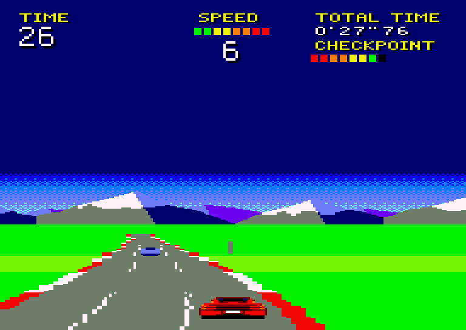

Ένα γρήγορο αμάξι, ένας μακρύς δρόμος και ποτέ αρκετός χρόνος. Τρέχεις κόντρα στο ρολόι σε πέντε στάδια, μέσα από στροφές, κορυφές και βυθίσματα, ανάμεσα στην κίνηση, σε δρόμο με τέσσερις, τρεις ή δύο λωρίδες. Στο τέλος κάθε σταδίου ο δρόμος διακλαδίζεται, και η πλευρά στην οποία βρίσκεσαι αποφασίζει πού θα πας μετά.

## Ξεκινώντας

### Τι χρειάζεσαι

- Έναν Amstrad CPC 6128 ή έναν εξομοιωτή του. Το παιχνίδι χρησιμοποιεί τα δεύτερα 64K μνήμης του 6128.
- Την εικόνα της δισκέτας, `countryride.dsk`.

Ως τώρα το παιχνίδι έχει δοκιμαστεί σε εξομοιωτές, ανάμεσά τους και το Retro Virtual Machine. Σε πραγματικό μηχάνημα δεν έχει δοκιμαστεί ακόμα.

### Φόρτωση

Βάλε τη δισκέτα και πληκτρολόγησε:

```
RUN"COUNTRY
```

Μετά πάτησε RETURN. Πρώτα εμφανίζεται για 10 δευτερόλεπτα η οθόνη του REVIVE8BIT (πάτησε SPACE για να την προσπεράσεις). Μετά εμφανίζεται η οθόνη τίτλου με τα τέσσερα αμάξια, και μετά από περίπου 20 δευτερόλεπτα αρχίζουν να γυρίζουν. Όταν εμφανιστεί ένα πλαίσιο που αναβοσβήνει γύρω από το πρώτο αμάξι, μπορείς να διαλέξεις το δικό σου. Μόλις διαλέξεις, φορτώνει το παιχνίδι, σε περίπου 20 δευτερόλεπτα ακόμη.

## Επιλογή αμαξιού και δυσκολίας

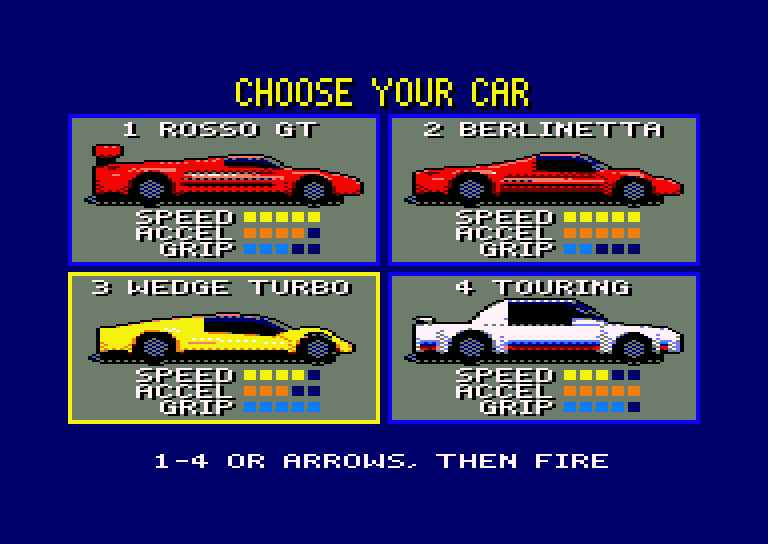

- Πάτησε **E**, **M** ή **H** για να διαλέξεις δυσκολία. Αυτή που διάλεξες αναβοσβήνει κάτω από τα αμάξια. Στην αρχή είναι διαλεγμένη η **MEDIUM**.
- Πάτησε **1** έως **4** για να διαλέξεις αμάξι και να ξεκινήσεις αμέσως.
- Ή μετακίνησε το πλαίσιο με τα **βελάκια**, τα **O** και **P** ή το **joystick** και ξεκίνα με **fire**, **space** ή **RETURN**.

Η δυσκολία ορίζει τι σου κοστίζει το χτύπημα σε αμάξι. Όλα τα άλλα μένουν ίδια.

| Δυσκολία | Χτύπημα σε αμάξι |
|---|---|
| **EASY** | Όπου κι αν το χτυπήσεις, πέφτεις λίγο κάτω από την ταχύτητα της κίνησης και σε σπρώχνει λίγο στο πλάι. |
| **MEDIUM** | Στη μέση του χάνεις το μεγαλύτερο μέρος της ταχύτητάς σου. Στην άκρη του χάνεις λιγότερη, αλλά πετάγεσαι πέρα στον δρόμο. |
| **HARD** | Όπως στο MEDIUM, αλλά χάνεις περισσότερη ταχύτητα και πετάγεσαι πιο μακριά. |

Τα τέσσερα αμάξια οδηγούνται διαφορετικά. Οι μπάρες στην οθόνη βαθμολογούν το καθένα με άριστα το πέντε:

| Αμάξι | Τι είναι | Speed | Accel | Grip |
|---|---|---|---|---|
| **ROSSO GT** | Φαρδύ κόκκινο σπορ, με χείλος στην ουρά και μεγάλες ζάντες | 5 | 4 | 3 |
| **BERLINETTA** | Φαρδύ κόκκινο σπορ, όπως βγήκε από το εργοστάσιο | 5 | 5 | 2 |
| **WEDGE TURBO** | Χαμηλή κίτρινη σφήνα με περσίδες στο καπό του κινητήρα | 4 | 3 | 5 |
| **TOURING** | Λευκό στέισον με αεροτομή πάνω από το πίσω τζάμι | 3 | 5 | 4 |

- **Speed** είναι η τελική ταχύτητα του αμαξιού.
- **Accel** είναι το πόσο γρήγορα τη φτάνει: τα δύο τρίτα της τελικής σε περίπου 6 έως 8 δευτερόλεπτα, το τελευταίο κομμάτι αργά, όπως ένας κινητήρας κοντά στο τέρμα του.
- **Grip** είναι το πόσο γρήγορα το στρίβεις πλάγια στον δρόμο και το πόσο λίγο το βγάζει έξω μια στροφή.

Τα αμάξια οδηγούν όπως αυτό του Out Run, και το ROSSO GT έτσι, αλλά στρίβουν με λίγο πάνω από τη μισή ταχύτητα. Με τέρμα ταχύτητα κρατάς μόνο τις πιο ήπιες στροφές: άφησε το γκάζι πριν από τις άλλες, και φρενάρισε στις κλειστές.

## Χειριστήρια

| Ενέργεια | Πληκτρολόγιο | Joystick |
|---|---|---|
| Στρίψιμο αριστερά | Βελάκι αριστερά, **O** | Αριστερά |
| Στρίψιμο δεξιά | Βελάκι δεξιά, **P** | Δεξιά |
| Γκάζι | **Space** | Fire |
| Φρένο | **Z** | Δεύτερο fire |
| Ταχύτητα LOW | Βελάκι πάνω, **Q** | Πάνω |
| Ταχύτητα HIGH | Βελάκι κάτω, **A** | Κάτω |
| Παύση και συνέχεια | **ESC** | |
| Μουσική κλειστή ή ανοιχτή | **M** | |

Τις ταχύτητες τις αλλάζεις μόνος σου, όπως στο Out Run. Ξεκινάς με LOW, που τραβάει δυνατά αλλά δεν πάει πάνω από τα δύο τρίτα της τελικής σου. Η HIGH φτάνει την τελική, αλλά τραβάει αδύναμα από χαμηλά: άλλαζε επάνω γύρω στη μισή τελική. Γύρνα σε LOW μετά από τρακάρισμα ή μεγάλη τράκα. Αν δεν κρατάς ούτε γκάζι ούτε φρένο, το αμάξι χάνει περίπου το ένα έκτο της τελικής του ταχύτητας το δευτερόλεπτο. Με το φρένο σταματά από τέρμα σε λιγότερο από δύο δευτερόλεπτα.

## Η οθόνη

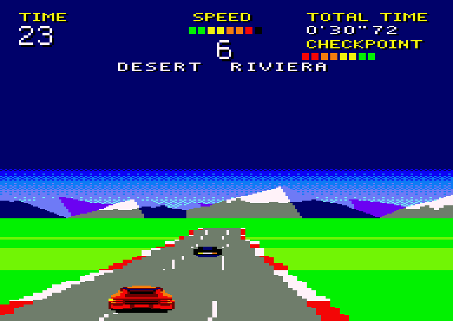

| Στην οθόνη | Τι σου δείχνει |
|---|---|
| **TIME** | Τα δευτερόλεπτα που σου μένουν. Στο 0 ο αγώνας τελειώνει. |
| **SPEED** | Μια μπάρα 8 τμημάτων και από κάτω η ταχύτητα που έχεις: L (LOW) ή H (HIGH). |
| **TOTAL TIME** | Πόση ώρα τρέχεις από το GO!. |
| **CHECKPOINT** | Μια μπάρα 8 τμημάτων που γεμίζει καθώς πλησιάζεις στο τέλος του σταδίου. |

Κάτω από την ταχύτητα υπάρχει μια γραμμή μηνυμάτων:

| Μήνυμα | Πότε εμφανίζεται |
|---|---|
| **PRESS FIRE** | Στο demo, αναβοσβήνοντας. Πάτησε fire για να τρέξεις. |
| **TOP TIMES** | Στο demo, και μετά οι πέντε καλύτεροι χρόνοι. |
| **GET READY** | Πριν από τον αγώνα. Μετά το μέτρημα 3, 2, 1 φαίνεται στη θέση της ταχύτητας. |
| **GO!** | Ο αγώνας άρχισε. |
| **STAGE 1** έως **STAGE 5** | Το στάδιο που ξεκινάς. |
| **DESERT  RIVIERA** | Διακλάδωση μπροστά: τα δύο στάδια που μπορείς να πάρεις, αριστερά και δεξιά. |
| **EXTENDED TIME** | Έφτασες σε checkpoint και πήρες κι άλλο χρόνο. |
| **TIME UP** | Το TIME έφτασε στο 0. |
| **FINISH** | Πέρασες το πέμπτο στάδιο. |
| **FASTEST TIME!** | Ο χρόνος σου είναι ο καλύτερος από τους πέντε. |
| **GAME OVER** | Ο αγώνας τελείωσε. |
| **PAUSE** | Πάτησες ESC. Πάτησέ το ξανά για να συνεχίσεις. |

## Ο αγώνας

### Η εκκίνηση

Όσο τρέχει το demo, πάτησε fire ή space. Εμφανίζεται το **GET READY**, ο δρόμος ισιώνει και το αμάξι φρενάρει ως το σταμάτημα στην τρίτη λωρίδα από αριστερά. Μετά το μέτρημα 3, 2, 1 έρχεται το **GO!** και ξεκινάς από στάση.

### Το ρολόι

Το **TIME** ξεκινά από τα 64 δευτερόλεπτα και μετρά αντίστροφα. Το **TOTAL TIME** μετρά προς τα πάνω.

Ο αγώνας έχει πέντε στάδια, περίπου μισό λεπτό το καθένα. Στο τέλος καθενός από τα τέσσερα πρώτα, το **EXTENDED TIME** προσθέτει χρόνο στο **TIME**: 44 δευτερόλεπτα στο πρώτο checkpoint και μετά 43, 42 και 41. Το **TIME** δεν ξεπερνά ποτέ το 99.

### Οι διακλαδώσεις

Λίγα δευτερόλεπτα πριν από κάθε checkpoint, η γραμμή μηνυμάτων δείχνει τα δύο στάδια που μπορούν να ακολουθήσουν: το αριστερό αριστερά και το δεξί δεξιά.

Δεν θα δεις τον δρόμο να χωρίζεται. Το μόνο που μετράει είναι πού βρίσκεσαι περίπου μισό δευτερόλεπτο πριν από το checkpoint:

- στην αριστερή πλευρά του δρόμου ή στη μέση του: το αριστερό στάδιο·
- στη δεξιά πλευρά του δρόμου: το δεξί στάδιο.

Συνολικά υπάρχουν εννέα στάδια και δεκαέξι διαδρομές ανάμεσά τους.

### Το τέλος

Μετά το πέμπτο στάδιο έρχεται το **FINISH**. Το αμάξι φρενάρει ως το σταμάτημα στην ευθεία που ακολουθεί, και το **TOTAL TIME** είναι ο χρόνος σου στον αγώνα.

Αν το **TIME** φτάσει πρώτα στο 0, εμφανίζεται το **TIME UP** και το αμάξι φρενάρει ως το σταμάτημα. Μπορείς ακόμα να το στρίβεις. Ακολουθεί το **GAME OVER**.

Και στις δύο περιπτώσεις, το demo συνεχίζει μετά από εκεί.

### Οι καλύτεροι χρόνοι

Το παιχνίδι κρατά τους πέντε καλύτερους χρόνους ως τον τερματισμό, όσο το μηχάνημα είναι ανοιχτό. Αρχικά είναι 2'37"50, 2'45"00, 2'52"50, 3'00"00 και 3'07"50. Ένας πιο γρήγορος αγώνας παίρνει τη θέση του ανάμεσά τους, και όλοι φαίνονται στο demo, μετά το **TOP TIMES**.

## Τα στάδια

Κάθε στάδιο έχει τον δικό του δρόμο και τα δικά του χρώματα, και κάθε επόμενο έχει περισσότερη κίνηση. Το πρώτο είναι πάντα το COUNTRYSIDE.

| Στάδιο | Αριστερά | Δεξιά |
|---|---|---|
| 1 | **COUNTRYSIDE**: στροφές και λόφοι εναλλάξ | |
| 2 | **DESERT**: μεγάλες ευθείες, ψηλές κορυφές | **RIVIERA**: η ακτή, με ανοιχτές ήπιες στροφές |
| 3 | **SUMMIT**: λόφος πίσω από λόφο, σε χιόνι και πάγο | **MESA**: φαράγγια, βαθιά βυθίσματα, κλειστές στροφές |
| 4 | **SUNSET**: μεγάλες ανοιχτές στροφές | **AUTUMN**: ελιγμοί πάνω σε λόφους |
| 5 | **NIGHT**: ελιγμοί στο σκοτάδι | **STORM**: γκρίζος ουρανός, δύσκολες στροφές |

| COUNTRYSIDE | DESERT | RIVIERA |
|---|---|---|
| 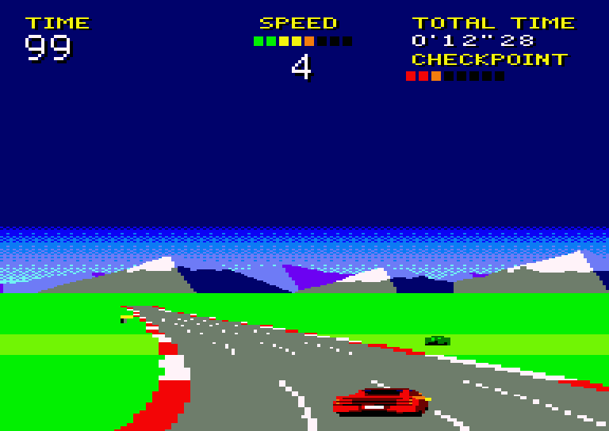 | 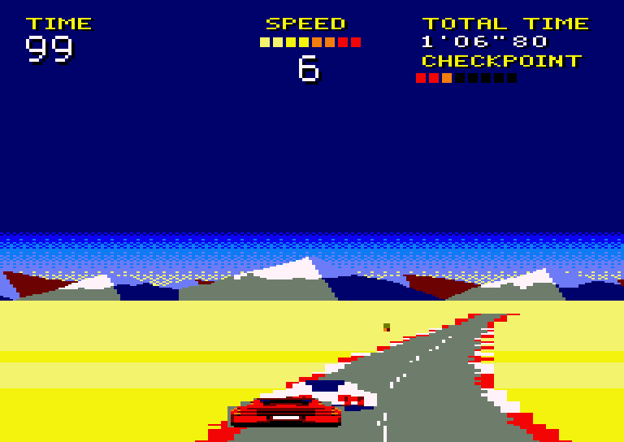 | 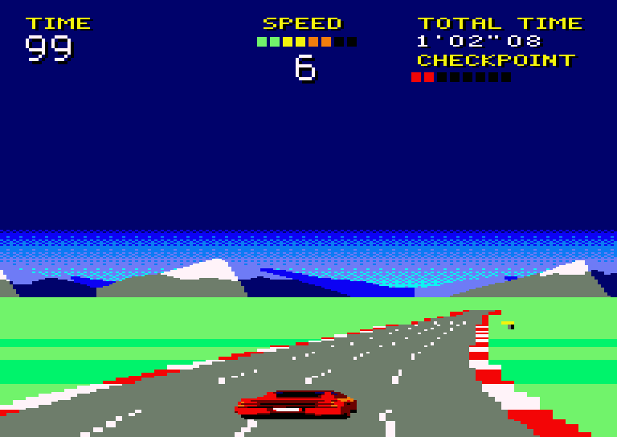 |

| SUMMIT | MESA | SUNSET |
|---|---|---|
| 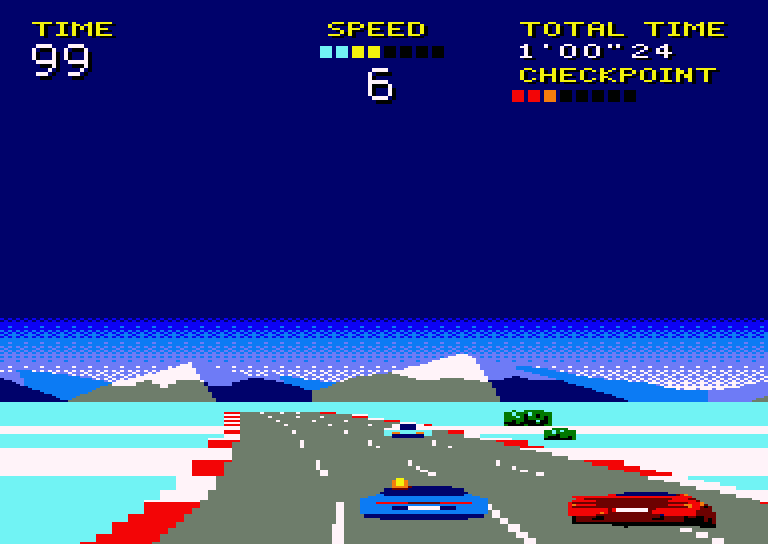 | 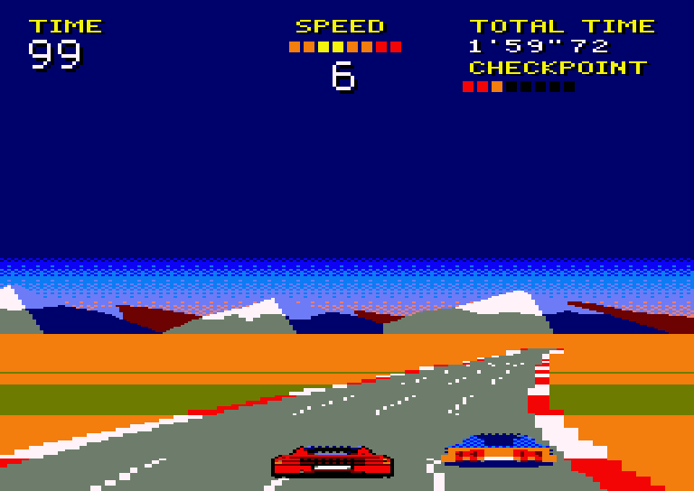 | 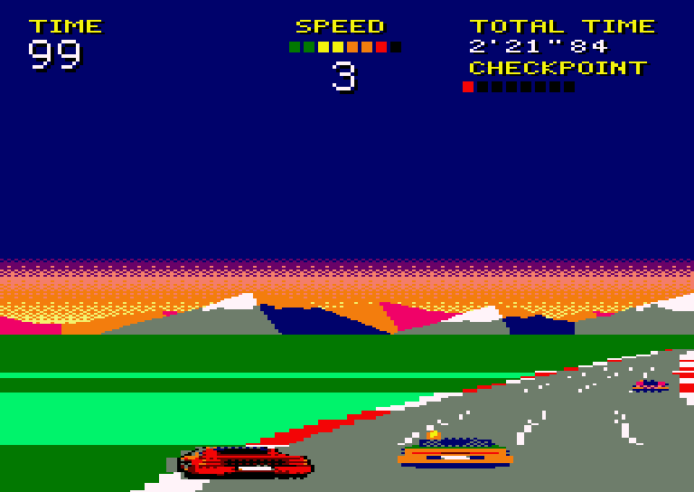 |

| AUTUMN | NIGHT | STORM |
|---|---|---|
| 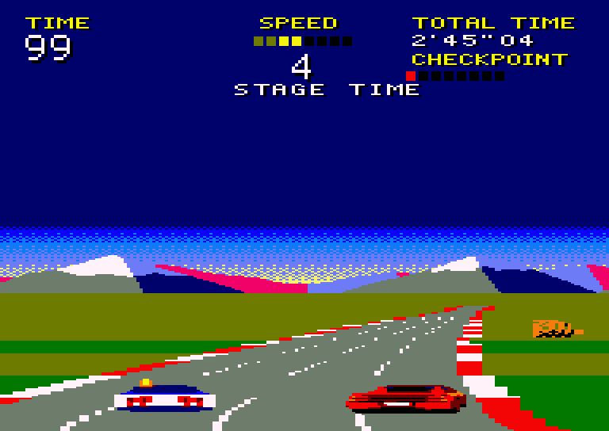 | 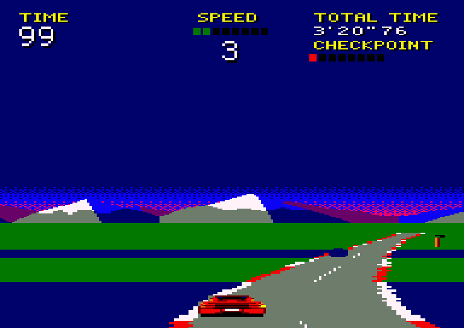 | 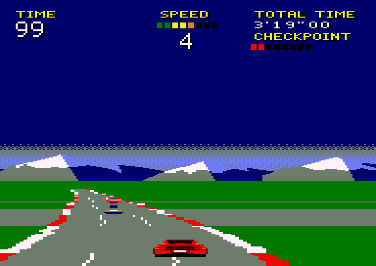 |

## Στον δρόμο

### Οι στροφές

Η στροφή παρασύρει το αμάξι προς την εξωτερική της πλευρά, αν δεν στρίψεις κόντρα της. Όσο πιο κλειστή η στροφή και όσο πιο γρήγορα πας, τόσο πιο δυνατά τραβά, και στις πιο κλειστές στροφές με μεγάλη ταχύτητα το αμάξι στρίβει και λιγότερο. Με τέρμα ταχύτητα όλες οι στροφές εκτός από τις πιο ήπιες τραβούν περισσότερο απ' όσο μπορείς να στρίψεις: άφησε για λίγο το γκάζι, ή φρενάρισε, πριν βγεις έξω.

| Πινακίδα | Τι σου δείχνει |
|---|---|
| 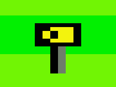 | **Κίτρινη πινακίδα με βέλη.** Στέκεται στην αρχή κάθε στροφής που δεν είναι ήπια, στην εξωτερική της πλευρά. Τα βέλη δείχνουν προς τα πού στρίβει. |
| 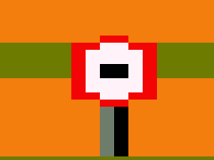 | **Όριο ταχύτητας.** Στέκεται δεξιά, πριν από τις πιο κλειστές στροφές. |

### Οι λωρίδες

Ο δρόμος έχει τέσσερις, τρεις ή δύο λωρίδες, και όσο λιγότερες τόσο στενότερος είναι. Εκεί που αλλάζει ο αριθμός τους, ο δρόμος στενεύει ή φαρδαίνει από τον ορίζοντα προς το μέρος σου, και η κίνηση πηγαίνει στις νέες λωρίδες πριν φτάσεις. Στις δύο λωρίδες οι στροφές είναι πιο ήπιες.

### Το γρασίδι

Με ρόδα στο γρασίδι το αμάξι δεν πάει πιο γρήγορα από τα τρία τέταρτα της τελικής του ταχύτητας, και μισή λωρίδα πιο έξω όχι πιο γρήγορα από τα δύο πέμπτα της. Με λιγότερες λωρίδες το γρασίδι αρχίζει πιο κοντά στη μέση του δρόμου.

### Η κίνηση

Έως δύο αμάξια τη φορά πηγαίνουν μπροστά σου, πιο αργά απ' όσο μπορεί να πάει το δικό σου. Έρχονται πιο συχνά όσο προχωράς, και πιο συχνά στο δεξί στάδιο μιας διακλάδωσης παρά στο αριστερό.

Ένα αμάξι με αναμμένο φλας πηγαίνει στη διπλανή λωρίδα από εκείνη την πλευρά. Και το δικό σου αμάξι βγάζει φλας όταν αλλάζεις θέση στον δρόμο.

**Τράκα.** Αν χτυπήσεις αμάξι, για ένα δευτερόλεπτο σε σπρώχνει μακριά του και κουνιέσαι, αλλά μπορείς να συνεχίσεις να στρίβεις. Το τι σου κοστίζει εξαρτάται από τη δυσκολία, και στα MEDIUM και HARD από το πού το χτύπησες. Στη μέση του χάνεις το μεγαλύτερο μέρος της ταχύτητάς σου και μετακινείσαι ελάχιστα στο πλάι. Στην άκρη του χάνεις λιγότερη, αλλά πετάγεσαι πέρα στον δρόμο, και έξω στο γρασίδι αν δεν στρίψεις αντίθετα. Αν όμως το χτυπήσεις με τα τρία τέταρτα της τελικής σου ταχύτητας ή περισσότερο, τρακάρεις, όπως παρακάτω: το αμάξι εκτινάσσεται και αναποδογυρίζει.

### Θάμνοι, δέντρα και πινακίδες

Αν χτυπήσεις θάμνο ή τον κορμό δέντρου ή πινακίδας, τρακάρεις. Για περίπου δύο δευτερόλεπτα το αμάξι στριφογυρίζει εκτός ελέγχου και σταματά. Μετά επιστρέφει στη μέση του δρόμου και ξεκινάς ξανά από στάση. Αν χτυπήσεις με τα τρία τέταρτα της τελικής σου ταχύτητας ή περισσότερο, το αμάξι εκτινάσσεται στον αέρα και αναποδογυρίζει πριν προσγειωθεί.

## Συμβουλές

- Κράτα πατημένο το γκάζι. Όταν το αφήνεις χάνεις ταχύτητα, και η ταχύτητα είναι χρόνος.
- Άλλαζε σε HIGH γύρω στη μισή τελική, και ξανά σε LOW όταν έχεις κόψει πολύ.
- Πρόσεχε τις κίτρινες πινακίδες και άρχισε να στρίβεις μόλις αρχίζει η στροφή.
- Κόψε πριν από μια κλειστή στροφή αντί να βγεις φαρδιά στο γρασίδι: σου κοστίζει λιγότερο.
- Μείνε μακριά από το γρασίδι. Σε κόβει απότομα, και εκεί γίνονται τα τρακαρίσματα.
- Άλλαξε λωρίδα νωρίς όταν έχεις αμάξι μπροστά. Μην προσπερνάς από την πλευρά που αναβοσβήνει το φλας του.
- Όταν εμφανιστούν τα δύο ονόματα σταδίων, πήγαινε έγκαιρα σε εκείνη την πλευρά του δρόμου.
- Αν χτυπήσεις αμάξι στην άκρη του, στρίψε αντίθετα στο σπρώξιμο για να μείνεις έξω από το γρασίδι.
- Τα τρακαρίσματα κοστίζουν πολύ περισσότερο χρόνο από τις τράκες: η τράκα περνά σε ένα δευτερόλεπτο και συνεχίζεις να κυλάς, ενώ το τρακάρισμα σε αφήνει σταματημένο.

## Ήχος

Ο αγώνας έχει τη δική του μουσική και το αμάξι τον κινητήρα του, που ανεβαίνει με την ταχύτητα και μουγκρίζει στο γρασίδι. Τα λάστιχα στριγγλίζουν στις δυνατές στροφές. Το μέτρημα κάνει μπιπ, το GO! και τα checkpoint κουδουνίζουν, οι τράκες και τα τρακαρίσματα έχουν τον θόρυβό τους, και τα TIME UP και FINISH τις δικές τους λίγες νότες.

Το **M** κλείνει τη μουσική ή την ανοίγει ξανά από την αρχή της, ενώ ο κινητήρας και τα εφέ συνεχίζουν. Μπορείς να το πατήσεις και στο demo, που αλλιώς είναι αθόρυβο, για να ισχύει στους επόμενους αγώνες.

## Συντελεστές

Country Ride. Revive8bit, 2026, Vasper.
