# Country Ride

**Game manual. A racing game for the Amstrad CPC 6128.**

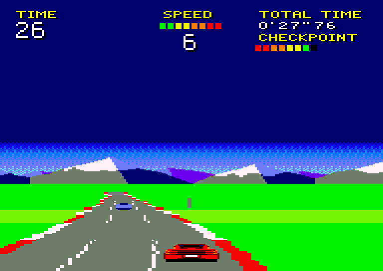

A fast car, a long road and never quite enough time. Race the clock over five stages, through curves, crests and dips, past the traffic, on a road of four, three or two lanes. At the end of each stage the road forks, and the side you are on decides where you go next.

## Getting started

### What you need

- An Amstrad CPC 6128, or an emulator of one. The game uses the 6128's second 64K of memory.
- The disc image, `countryride.dsk`.

So far the game has been tested in emulators, including Retro Virtual Machine. It has not been tried on real hardware yet.

### Loading

Insert the disc and type:

```
RUN"COUNTRY
```

Then press RETURN. The title screen with the four cars appears, and after about 20 seconds they start turning round. When a flashing frame appears around the first car, you can pick yours. Once you have, the game loads, which takes about 20 seconds more.

## Picking a car and the difficulty

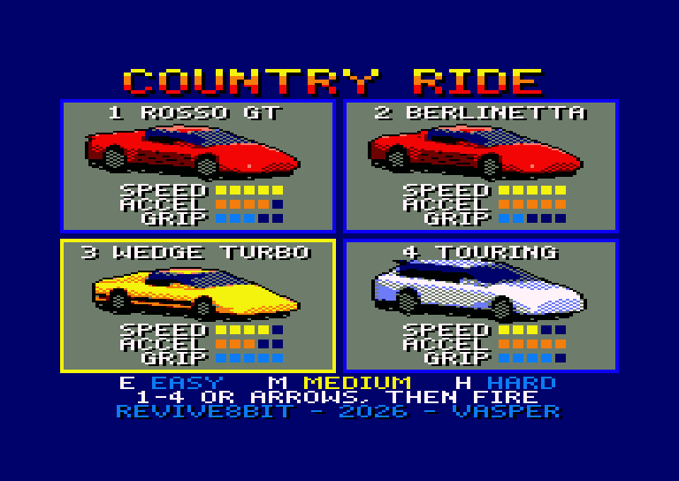

- Press **E**, **M** or **H** to pick the difficulty. The one you pick flashes under the cars. **MEDIUM** is picked to begin with.
- Press **1** to **4** to pick a car and start at once.
- Or move the flashing frame with the **cursor keys**, **O** and **P**, or the **joystick**, then start with **fire**, **space** or **RETURN**.

The difficulty decides what hitting a car costs you. Everything else is the same.

| Difficulty | Hitting a car |
|---|---|
| **EASY** | Wherever you hit it, you drop to just below the traffic's speed and are pushed a little to the side. |
| **MEDIUM** | Square on, you lose most of your speed. Off its side you lose less, but you are thrown across the road. |
| **HARD** | As on MEDIUM, but you lose more speed and are thrown further. |

The four cars drive differently. The bars on the screen rate each one out of five:

| Car | What it is | Speed | Accel | Grip |
|---|---|---|---|---|
| **ROSSO GT** | Wide red sports car, with a lip on its tail and big rims | 5 | 4 | 3 |
| **BERLINETTA** | Wide red sports car, as it left the factory | 5 | 5 | 2 |
| **WEDGE TURBO** | Low yellow wedge with a louvred engine cover | 4 | 3 | 5 |
| **TOURING** | White estate with a spoiler over its rear window | 3 | 5 | 4 |

- **Speed** is the car's top speed.
- **Accel** is how quickly it gets there, from about 5 to 8 seconds.
- **Grip** is how quickly you can steer it across the road, and how little a curve carries it outwards.

At full speed the two red cars have to slow down for the sharpest curves. The other two can hold them.

## Controls

| Action | Keyboard | Joystick |
|---|---|---|
| Steer left | Cursor left, **O** | Left |
| Steer right | Cursor right, **P** | Right |
| Faster | Cursor up, **Q**, **space** | Up or fire |
| Slower | Cursor down, **A** | Down |
| Pause, and go on | **ESC** | |
| Music off, or on again | **M** | |

The gears change by themselves. With neither Faster nor Slower held, the car slowly loses speed.

## The screen

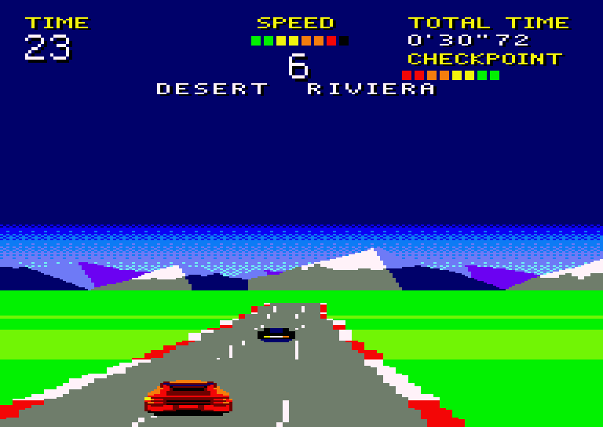

| On the screen | What it tells you |
|---|---|
| **TIME** | The seconds you have left. At 0 the race is over. |
| **SPEED** | A gauge of 8 segments, with your gear under it: N, then 1 to 6. |
| **TOTAL TIME** | How long you have been racing since GO!. |
| **CHECKPOINT** | A gauge of 8 segments that fills on the way to the end of the stage. |

Under the gear is a line of messages:

| Message | When it shows |
|---|---|
| **PRESS FIRE** | In the demo, blinking. Press fire to race. |
| **TOP TIMES** | In the demo, followed by the five best times. |
| **GET READY** | Before the race. The count 3, 2, 1 then shows where the gear is. |
| **GO!** | The race has begun. |
| **STAGE 1** to **STAGE 5** | The stage you are starting. |
| **DESERT  RIVIERA** | A fork ahead: the two stages you can take, left and right. |
| **EXTENDED TIME** | You reached a checkpoint, and got more time. |
| **TIME UP** | TIME has reached 0. |
| **FINISH** | You got past the fifth stage. |
| **FASTEST TIME!** | Your time is the best of the five. |
| **GAME OVER** | The race is over. |
| **PAUSE** | You pressed ESC. Press it again to go on. |

## The race

### The start

While the demo drives, press fire or any of the Faster keys. **GET READY** shows, the road flattens out and straightens, and the car brakes to a standstill in the third lane from the left. After the count of 3, 2, 1 comes **GO!**, and you drive off from a standstill.

### The clock

**TIME** starts at 53 seconds and counts down. **TOTAL TIME** counts up.

A race is five stages of about half a minute each. At the end of each of the first four, **EXTENDED TIME** adds to your **TIME**: 37 seconds at the first checkpoint, then 36, 35 and 34. **TIME** never goes above 99.

### The forks

A few seconds before each checkpoint, the message line shows the two stages that can come next, the left one on the left and the right one on the right.

You will not see the road split. All that counts is where you are about half a second before the checkpoint:

- on the left of the road, or on its middle: the left stage;
- on the right of the road: the right stage.

There are nine stages in all, and sixteen routes through them.

### The end

Past the fifth stage comes **FINISH**. The car brakes to a standstill on the straight that follows, and **TOTAL TIME** is your time for the race.

If **TIME** reaches 0 first, **TIME UP** shows and the car brakes to a standstill. You can still steer it. **GAME OVER** follows.

Either way, the demo then drives on from there.

### The best times

The game keeps the five best times to the finish for as long as the machine is on. They start at 2'37"50, 2'45"00, 2'52"50, 3'00"00 and 3'07"50. A faster race takes its place among them, and they all show in the demo, after **TOP TIMES**.

## The stages

Each stage has its own road and colours, and each next stage has more traffic. The first is always the COUNTRYSIDE.

| Stage | Left | Right |
|---|---|---|
| 1 | **COUNTRYSIDE**: curves and hills by turns | |
| 2 | **DESERT**: long straights, big crests | **RIVIERA**: the coast, sweeping and gentle |
| 3 | **SUMMIT**: hill after hill, in snow and ice | **MESA**: canyons, deep dips, sharp curves |
| 4 | **SUNSET**: long sweeping curves | **AUTUMN**: winding over hills |
| 5 | **NIGHT**: winding in the dark | **STORM**: grey skies, hard curves |

| COUNTRYSIDE | DESERT | RIVIERA |
|---|---|---|
| 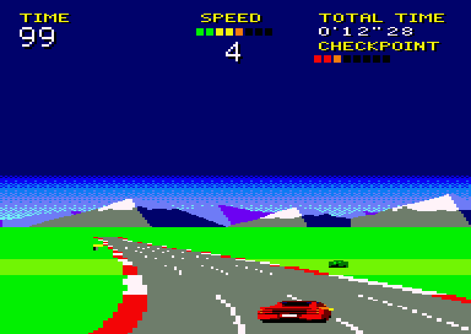 | 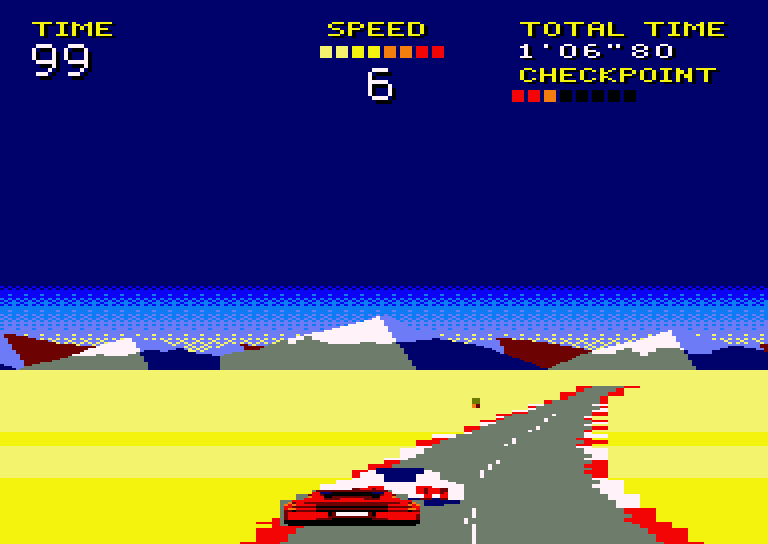 | 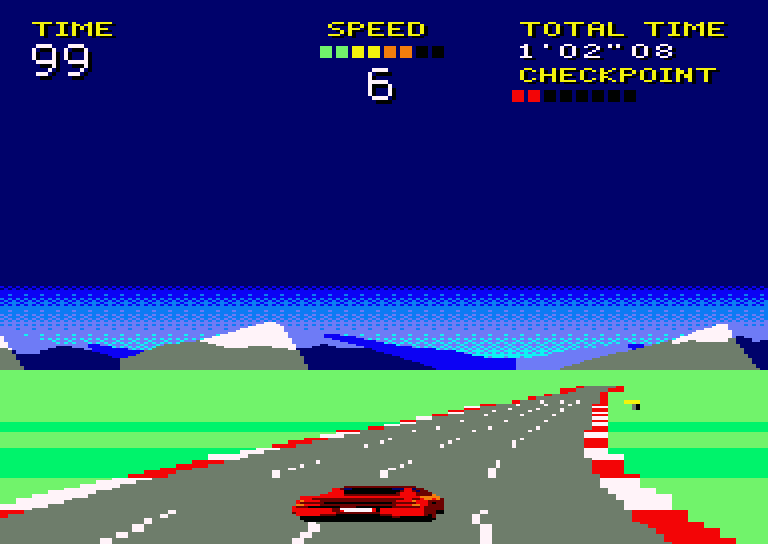 |

| SUMMIT | MESA | SUNSET |
|---|---|---|
| 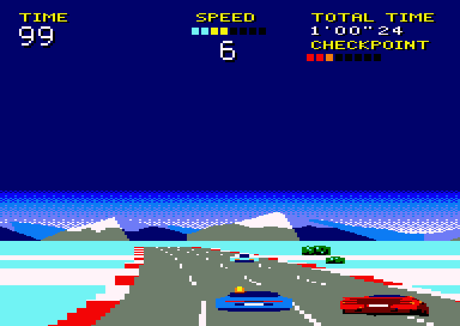 | 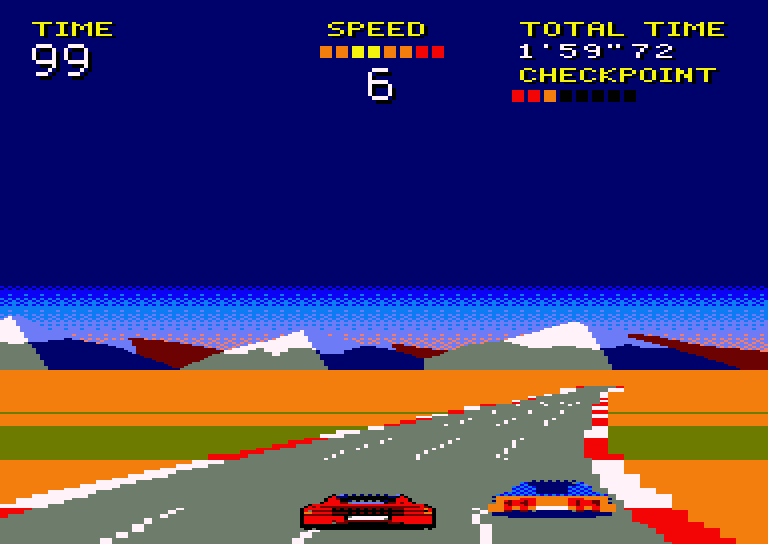 | 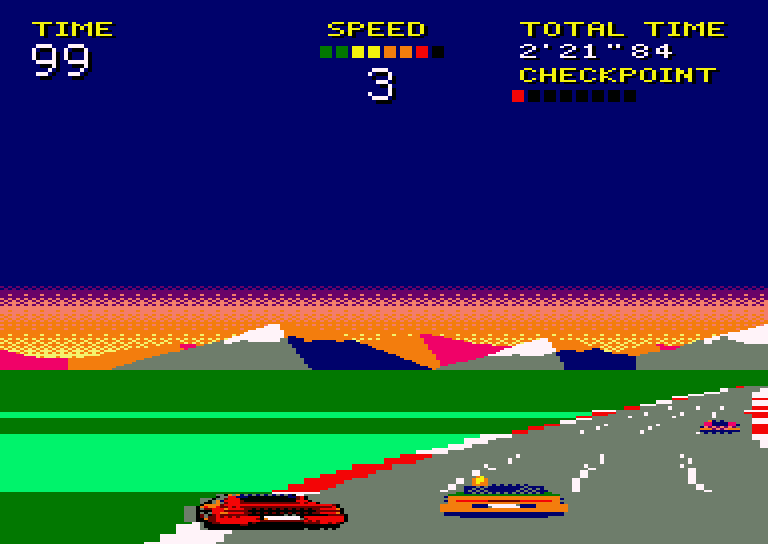 |

| AUTUMN | NIGHT | STORM |
|---|---|---|
| 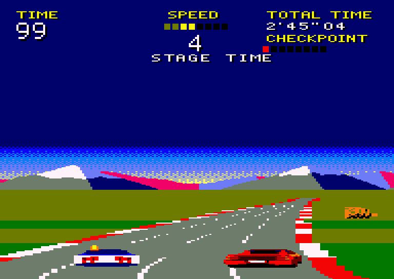 | 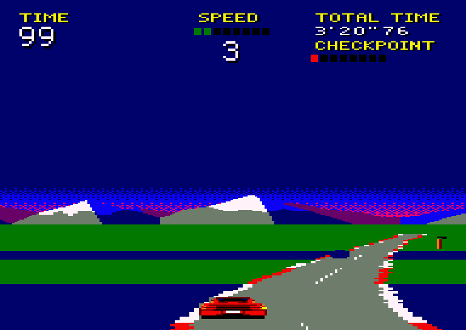 | 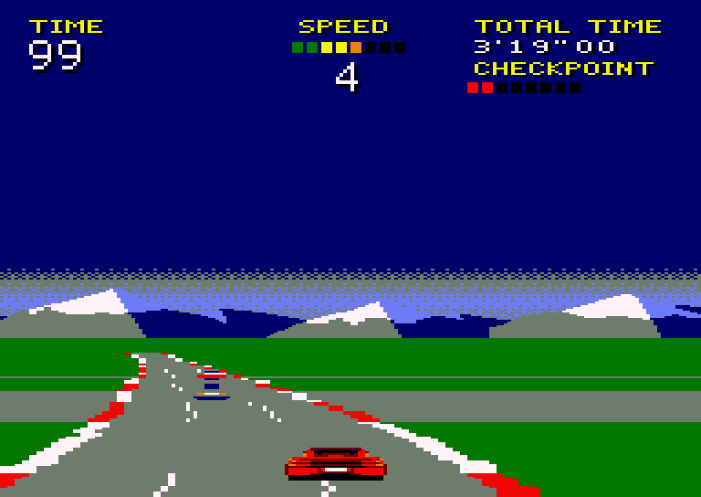 |

## On the road

### Curves

A curve carries the car towards its outside unless you steer against it. The sharper the curve and the faster you go, the harder it pulls. Steering also costs you up to one segment of the speed gauge.

| Sign | What it tells you |
|---|---|
| 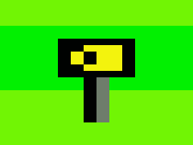 | **Yellow board with chevrons.** Stands at the start of any curve that is more than gentle, on its outside. The chevrons point the way it bends. |
| 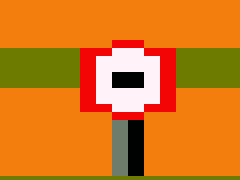 | **Speed limit.** Stands on the right before the sharpest curves. |

### Lanes

The road has four, three or two lanes, and it is narrower with fewer. Where the number changes, the road narrows or widens from the horizon towards you, and the traffic moves over before you get there. On two lanes the curves are gentler.

### The grass

With a wheel on the grass the car goes no faster than half its top speed. With fewer lanes the grass begins nearer the middle of the road.

### Traffic

Up to two cars at a time drive ahead of you, slower than your car can go. They come more often the further you get, and more often on a fork's right-hand stage than on its left.

A car with a flashing indicator is moving over to the next lane on that side. Your own car flashes too when you move across the road.

**A bump.** Hit a car and for a second you are shoved away from it, wobbling, though you can go on steering. What it costs depends on the difficulty, and on MEDIUM and HARD on where you hit it. Square on, you lose most of your speed and hardly move sideways. Off its side, you lose less, but you are thrown across the road, and out onto the grass unless you steer against it.

### Bushes, trees and signs

Hit a bush, or the trunk of a tree or sign, and you crash. For about two seconds the car spins out of your control and comes to a standstill. It is then brought back to the middle of the road, and you drive off from a standstill. Hit one at four fifths of your top speed or more, and the car is thrown up into the air as well.

## Tips

- Keep Faster held. Letting go loses speed, and speed is time.
- Watch for the yellow boards, and start steering as the curve starts.
- Steer only when you need to: every turn costs a segment of the gauge.
- Stay off the grass. It halves your speed, and it is where the crashes are.
- Move out early when a car is ahead. Do not pass on the side its indicator is flashing.
- When the two stage names appear, get to that side of the road in good time.
- After hitting a car off its side, steer against the shove to stay off the grass.
- Crashes cost far more time than bumps. A bump is over in a second and leaves you rolling, while a crash leaves you at a standstill.

## Sound

The race has its own music, and the car its engine, whose note rises with your speed and rumbles on the grass. The tyres squeal in hard turns. The count beeps, GO! and the checkpoints ring, bumps and crashes have their noise, and TIME UP and FINISH have their own few notes.

**M** turns the music off, or on again from the start of the tune, and the engine and the effects go on. You can also press it in the demo, which is otherwise silent, to set it for the races to come.

## Credits

Country Ride. Revive8bit, 2026, Vasper.
